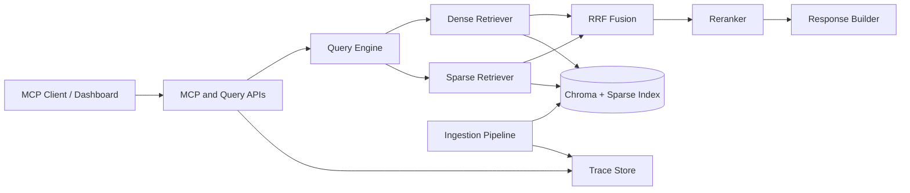

# Runtime Topology

## Query path

1. Query preprocessing and optional rewrite
2. Dense and sparse retrieval
3. RRF fusion
4. Reranking
5. Citation and multimodal response assembly
6. Trace persistence

## Ingestion path

1. Load document
2. Semantic chunking
3. Chunk refinement and metadata enrichment
4. Image captioning when required
5. Vector and keyword index writes
6. Ingestion history persistence