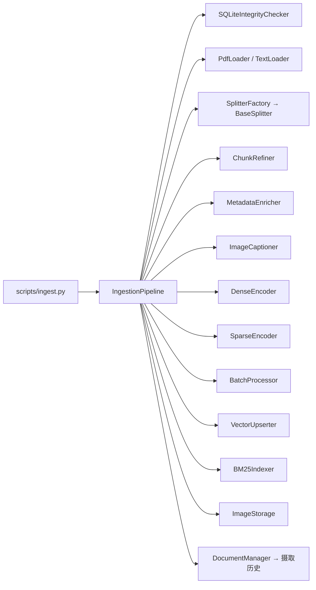

# Technical Plan: Ingestion Pipeline

| 字段 | 值 |
|---|---|
| Spec | `001-ingestion-pipeline` |
| Status | implemented |
| Components | `src/ingestion/{pipeline,document_manager,chunking,transform,embedding,storage}`、`src/libs/{loader,splitter,embedding}`、`scripts/ingest.py` |
| State | 向量在 Chroma、稀疏索引在 BM25 目录、摄取历史与图片映射在 SQLite、Trace 在 JSONL |
| Rollback | 回退代码即可；本地数据目录可删除后重建，确定性 id 保证重跑结果一致 |

## 1. 处理伪代码

```python
class IngestionPipeline:
    def process(self, path: Path, collection: str | None = None, force: bool = False) -> PipelineResult:
        trace = TraceContext(trace_type="ingestion")
        doc_id = self.integrity.compute_sha256(path)
        if not force and self.integrity.should_skip(doc_id):
            return PipelineResult(success=True, doc_id=doc_id, chunk_count=0)

        document = self.loader.load(path)                       # 必需
        chunks = self.chunker.split(document)                   # 必需
        chunks = self.refiner.refine(chunks)                    # 可降级
        chunks = self.enricher.enrich(chunks)                   # 可降级
        captions = self.captioner.caption(document)             # 可降级
        vectors = self.batch_processor.run(self.dense_encoder, chunks)   # 必需
        sparse = self.sparse_encoder.encode(chunks)             # 必需

        self.upserter.upsert(chunks, vectors, collection)       # 幂等
        self.bm25.upsert(sparse, collection)
        self.image_storage.persist(captions)
        self.history.mark_success(doc_id, len(chunks))

        trace.finish()
        TraceCollector().collect(trace)
        return PipelineResult(success=True, doc_id=doc_id, chunk_count=len(chunks))
```

## 2. 组件交互



## 3. 完整性检查

`SQLiteIntegrityChecker` 三张语义：`compute_sha256()`、`should_skip(hash)`、`mark_success/mark_failure(hash)`。

- 只有**成功**的记录才导致跳过，失败记录保留但允许重试。
- WAL 模式让 Dashboard 读取历史与 CLI 写入历史不互相阻塞。
- 数据库文件位于 `data/` 下，与向量库同属运行期数据，不入库。

## 4. 加载与分块

- Loader 通过抽象基类接入；PDF 走 `markitdown`，文本/Markdown 直接读。
- Splitter 由 `SplitterFactory` 按 `ingestion.splitter` 选择；默认 `recursive`。
- 默认 `chunk_size=1000`、`chunk_overlap=200`：重叠用于避免关键句跨 chunk 被切断，代价是约 20% 的额外存储与向量化调用。
- 边界：空文档或全空白返回 `[]`，不抛异常——空文件是合法输入，只是没有可检索内容。

## 5. Transform 的双路径结构

```python
def refine(self, chunks):
    if not self.use_llm:
        return self._rule_based(chunks)
    try:
        return self._llm_based(chunks)      # Prompt: config/prompts/chunk_refinement.txt
    except Exception as err:
        logger.warning("chunk refinement LLM failed, falling back: %s", err)
        return self._rule_based(chunks)
```

`MetadataEnricher` 结构相同，Prompt 为 `metadata_enrichment.txt`。`ImageCaptioner` 使用 `image_captioning.txt` 与 Vision LLM，失败时跳过该图片。

约束：Prompt 文本必须来自配置文件而不是硬编码，这样 Prompt 调优不需要改代码、不需要跑测试。

## 6. 编码与批处理

- `DenseEncoder` 通过 `EmbeddingFactory` 获取实现，禁止直接实例化 Provider。
- `SparseEncoder` 负责分词（jieba）与词频统计，输出结构与 `BM25Indexer` 的写入契约对齐。
- `BatchProcessor` 按 `batch_size=100` 切批，保持输入输出顺序一致，失败时报告具体批次位置。
- 顺序一致是必需的：向量与 chunk 靠下标配对，顺序错位会把错误的向量写到正确的文本上——这类 bug 在检索结果里表现为「语义完全无关」，极难定位。

## 7. 写入

```python
def deterministic_id(chunk) -> str:
    doc_prefix = sha256_of_file[:8]
    content_prefix = sha256(chunk.text)[:8]
    return f"{doc_prefix}_{chunk.metadata['chunk_index']:04d}_{content_prefix}"
```

- 同内容 → 同 id → 覆盖写入，因此重复摄取天然幂等。
- 内容变化 → 内容哈希变化 → 新 id，旧记录保留可供对比。
- 不使用自增 ID：增量摄取与重跑无法保证顺序一致。

三套存储共享同一批 `chunk_id`，这是双路召回能融合的前提。

## 8. 文档级操作

`DocumentManager` 提供列表、详情、删除。删除必须按顺序清理：向量记录 → BM25 条目 → 图片映射 → 文件 → 历史记录。任一步失败都要报告，因为留下悬空引用会导致「检索得到 id 但取不回文本」。

## 9. Trace 与进度

- 每个阶段 `trace.record_stage(name, data, elapsed_ms)`；阶段名固定（见 spec §10）。
- `on_progress` 回调在阶段切换时触发，Dashboard「摄取管理」页据此显示进度。
- Trace 在 `finally` 语义下收敛，确保失败路径也能落盘。

## 10. CLI

```text
--path     文件或目录（目录会展开为待处理文件列表）
--collection  目标集合名
--force    忽略完整性检查强制重跑
--config   指定配置文件

退出码：0 全部成功 / 1 部分失败 / 2 全部失败或配置错误
```

退出码是为了让 CI 与批处理脚本能够区分「一个文件坏了」和「配置写错了」。

## 11. 风险与缓解

| 风险 | 影响 | 缓解 |
|---|---|---|
| 重复摄取 | 索引膨胀、结果重复 | SHA256 跳过 + 确定性 id 覆盖 |
| 标识不确定 | 重跑产生新旧两份 | 内容哈希参与 id |
| 顺序错位 | 向量与文本不匹配 | 批处理保持顺序 + 失败定位 |
| 可选组件失败 | 整批中断 | 规则回退 / 跳过 |
| 跨存储不一致 | 检索到取不回 | 删除按依赖顺序清理；重跑修复 |
| Trace 落盘失败 | 观测缺失 | 只记日志，不影响返回 |
| 大文件内存压力 | OOM | 分批编码；单文件失败不拖垮整批 |
| 中文分词质量 | 稀疏召回差 | jieba + BM25 可替换；向量路径兜底 |

## 12. 验证

```bash
pytest -m unit
pytest tests/unit/test_file_integrity.py tests/unit/test_document_chunker.py -v
pytest tests/unit/test_vector_upserter_idempotency.py tests/unit/test_bm25_indexer_roundtrip.py -v
pytest tests/integration/test_ingestion_pipeline.py tests/integration/test_ingestion_trace.py -v
python scripts/ingest.py --path tests/fixtures/sample_documents --collection smoke
```

## 13. 回滚

代码可直接回退。本地数据目录（`data/`、`logs/`）属于运行期产物，可删除后凭确定性 id 重跑得到一致结果；唯一需要人工确认的是「部分写入」状态——重跑同一文件即可由幂等覆盖修正。
