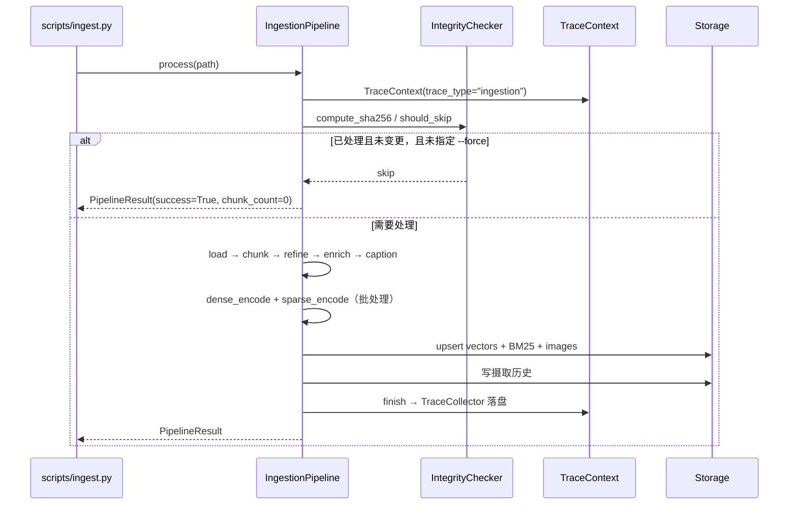

# Feature Specification: Ingestion Pipeline

| 字段 | 值 |
|---|---|
| Spec ID | `001-ingestion-pipeline` |
| Status | implemented |
| Version | 2.0.0 |
| Owner | Ingestion layer |
| Scope | 文件完整性检查、加载、分块、Transform、编码、索引写入与摄取历史 |
| Related | `specs/002-hybrid-retrieval`、`specs/004-trace-evaluation`、`DEV_SPEC.md` §6.1 §7 §8 |
| Evidence | `src/ingestion/pipeline.py`、`src/ingestion/chunking/`、`src/ingestion/transform/`、`src/ingestion/embedding/`、`src/ingestion/storage/`、`src/libs/loader/`、`scripts/ingest.py`、`tests/unit/`、`tests/integration/test_ingestion_pipeline.py` |

## 1. 背景

摄取是 RAG 系统的数据入口，它同时承担四类责任：把文件变成文本、把文本变成可检索单元、把可检索单元写进两套索引、把「做过什么」记下来。

这四件事的失败模式差别很大：

| 失败 | 后果 |
|---|---|
| 重复摄取同一文件 | 索引膨胀、检索结果重复 |
| 标识不确定 | 重跑后出现新旧两份内容，无法判断哪份有效 |
| 分块破坏语义 | 关键句被切断，检索永远召回不到 |
| 可选增强组件（LLM 精炼 / Caption）失败 | 整批摄取中断，用户拿不到任何结果 |
| 写入中途失败 | 向量库与 BM25 不一致 |
| 没有历史记录 | 无法判断某个文件是否已处理、失败在哪一步 |

Ingestion Pipeline 的职责是把这些失败模式变成确定行为。

## 2. 目标

- 同一文件重复摄取必须幂等；文件内容变化必须产生可区分的新标识。
- 全链路产生确定性标识，不依赖自增序列或时间戳。
- 可选增强组件失败时降级为规则路径或跳过，不阻断其余 chunk 落库。
- 摄取每个阶段都可观测（阶段名、耗时、Provider、错误）。
- 编码与写入支持批处理，并能在中断后重跑恢复。
- 命令行入口给出可判读的退出码。

## 3. 非目标

- 不实现分布式并发摄取与锁协调。
- 不实现 OCR、表格结构还原与视频解析。
- 不实现增量更新（文件内容变化时新增 chunk，不做旧 chunk 的差异删除）。
- 不实现跨存储事务（向量库 / BM25 / SQLite 之间无两阶段提交）。
- 不提供生产级吞吐与容量基线。

## 4. 角色与边界

| 角色 | 可以做 | 不可以做 |
|---|---|---|
| `scripts/ingest.py` | 解析参数、调用 Pipeline、输出统计、返回退出码 | 直接写索引 |
| `IngestionPipeline` | 编排阶段、聚合统计、触发 Trace、报告进度 | 实现具体解析或编码算法 |
| Loader / Splitter / Transform / Encoder | 单一阶段的纯转换 | 决定后续阶段是否执行 |
| Storage 组件 | 幂等写入与索引维护 | 修改 chunk 内容 |
| `DocumentManager` | 文档级查询与删除 | 参与摄取阶段 |

## 5. 功能需求

### 5.1 完整性检查与幂等

| ID | 优先级 | 需求 | 验证 |
|---|---|---|---|
| R-ING-01 | P0 | `doc_id` 必须等于文件二进制内容的 SHA256。 | `tests/unit/test_file_integrity.py` |
| R-ING-02 | P0 | 已成功处理过的文件默认跳过；`--force` 可强制重跑。 | 集成用例 |
| R-ING-03 | P0 | 摄取失败的记录必须保留，且不得阻止同一文件重试。 | `test_file_integrity.py` |
| R-ING-04 | P0 | 检查器状态落 SQLite，进程重启后仍然有效。 | 集成用例 |
| R-ING-05 | P1 | SQLite 使用 WAL 模式以支持并发读写。 | 实现检查 |

### 5.2 加载与分块

| ID | 优先级 | 需求 | 验证 |
|---|---|---|---|
| R-ING-06 | P0 | 加载器必须通过抽象基类接入，至少支持 PDF 与文本/Markdown。 | `test_loader_pdf_contract.py` |
| R-ING-07 | P0 | 分块策略由 `ingestion.splitter` 选择：`recursive` / `semantic` / `fixed_length`。 | `test_splitter_factory.py` |
| R-ING-08 | P0 | 分块参数为 `chunk_size=1000`、`chunk_overlap=200`，可由配置覆盖。 | `test_document_chunker.py` |
| R-ING-09 | P1 | 空文档与全空白文档必须返回空 chunk 列表而不是抛异常。 | `test_document_chunker.py` |

### 5.3 Transform

| ID | 优先级 | 需求 | 验证 |
|---|---|---|---|
| R-ING-10 | P0 | `ChunkRefiner` 在 `use_llm=false` 或 LLM 调用失败时必须回退到规则去噪。 | `test_chunk_refiner.py` |
| R-ING-11 | P0 | `MetadataEnricher` 在 `use_llm=false` 或 LLM 调用失败时必须回退到规则增强。 | `test_metadata_enricher_contract.py` |
| R-ING-12 | P1 | `ImageCaptioner` 在 `vision_llm.enabled=false` 或调用失败时跳过该图片，不阻断其余处理。 | `test_image_storage.py` |
| R-ING-13 | P2 | Transform 阶段使用 `config/prompts/` 下的 Prompt 文件，不允许把 Prompt 硬编码在代码里。 | 代码审查 |

### 5.4 编码

| ID | 优先级 | 需求 | 验证 |
|---|---|---|---|
| R-ING-14 | P0 | Dense 编码必须通过 Embedding Factory 获取实现，不直接实例化 Provider。 | `test_dense_encoder.py` |
| R-ING-15 | P0 | Sparse 编码必须输出与 BM25 索引兼容的统计结构。 | `test_sparse_encoder.py` |
| R-ING-16 | P1 | 批处理按 `ingestion.batch_size`（默认 100）切批，并保持输入输出顺序一致。 | `test_batch_processor.py` |
| R-ING-17 | P0 | 批处理任一 chunk 失败必须报告失败位置，而不是静默丢数据。 | `test_batch_processor.py` |

### 5.5 写入与历史

| ID | 优先级 | 需求 | 验证 |
|---|---|---|---|
| R-ING-18 | P0 | `chunk_id` 必须由「doc 前缀 + 零填充序号 + 内容哈希前缀」确定，同内容产出同 id。 | `test_vector_upserter_idempotency.py` |
| R-ING-19 | P0 | 同 id 重复写入必须覆盖而非新增。 | `test_vector_upserter_idempotency.py` |
| R-ING-20 | P0 | BM25 索引必须能在写入后加载并往返查询一致。 | `test_bm25_indexer_roundtrip.py` |
| R-ING-21 | P1 | 图片落盘后必须建立映射记录，供查询阶段回查。 | `test_image_storage.py` |
| R-ING-22 | P1 | 摄取历史必须记录文件、`doc_id`、chunk 数与结果状态。 | `test_document_manager.py` |
| R-ING-23 | P1 | 删除文档必须同时清理向量、BM25 条目与图片映射。 | `test_document_manager.py` |

### 5.6 编排与入口

| ID | 优先级 | 需求 | 验证 |
|---|---|---|---|
| R-ING-24 | P0 | Pipeline 必须为每个阶段记录 Trace 阶段名、耗时与 Provider。 | `tests/integration/test_ingestion_trace.py` |
| R-ING-25 | P1 | Pipeline 支持进度回调 `on_progress`，报告当前阶段与进度。 | `test_pipeline_progress.py` |
| R-ING-26 | P1 | `scripts/ingest.py` 支持单文件与目录、`--collection`、`--force`、`--config`。 | CLI 用例 |
| R-ING-27 | P1 | 退出码：0 全部成功；1 部分失败；2 全部失败或配置错误。 | CLI 用例 |

## 6. 对外契约

```text
CLI
  python scripts/ingest.py --path <file|dir> [--collection <name>] [--force] [--config <path>]
  退出码 0 / 1 / 2

Pipeline
  IngestionPipeline.process(path) -> PipelineResult
  PipelineResult:
    success: bool
    file_path: str
    doc_id: str
    chunk_count: int
    stage_timings / errors
```

## 7. 数据契约

```text
doc_id   = SHA256(file bytes)
chunk_id = f"{doc_id[:8]}_{chunk_index:04d}_{sha256(chunk.text)[:8]}"

Chunk.metadata 至少包含 source_path 与 chunk_index
写入记录：id / 向量 / 文本 / 元数据 / collection
```

## 8. 时序



## 9. 失败行为

| 场景 | 行为 |
|---|---|
| 文件不存在或不可读 | 返回失败，退出码 2（全部失败） |
| 文件已处理且未变更 | 跳过，`success=True`、`chunk_count=0` |
| 加载失败（格式损坏） | 该文件失败，退出码 1；其余文件继续 |
| 分块得到空列表 | 视为成功但 chunk 数为 0，并在 Trace 中记录 |
| LLM 精炼/增强失败 | 回退规则路径，摄取继续 |
| Vision Caption 失败 | 跳过该图片，其余 chunk 继续 |
| Embedding 调用失败 | 该文件失败，退出码 1；可重试 |
| 批处理中途失败 | 报告失败位置，不静默丢数据 |
| Trace 落盘失败 | 记录异常日志，返回值不受影响 |
| 写入中途进程被杀死 | 可能留下部分写入；重跑同一文件靠确定性 id 覆盖修正 |
| 配置缺失必填字段 | `SettingsError`，退出码 2，不开始处理 |

## 10. 可观测性

- Trace 阶段（`trace_type="ingestion"`）：`integrity_check`、`load`、`chunk`、`refine`、`enrich`、`caption`、`dense_encode`、`sparse_encode`、`upsert`、`history`。
- 阶段记录字段：阶段名、方法/Provider、耗时、关键计数、错误信息。
- CLI 输出：每个文件的处理结果与最终汇总；退出码可用于脚本与 CI 判定。
- Dashboard「摄取追踪」页按 Trace 渲染瀑布，可定位某个文件的耗时分布。

## 11. 验收标准

| AC | 内容 | 方式 |
|---|---|---|
| AC1 | 同一文件两次摄取只产生一份数据 | `pytest tests/unit/test_vector_upserter_idempotency.py -v` |
| AC2 | SHA256 相同则跳过，`--force` 强制重跑 | `pytest tests/unit/test_file_integrity.py -v` |
| AC3 | 分块参数生效，空文档返回空列表 | `pytest tests/unit/test_document_chunker.py -v` |
| AC4 | Transform 在 LLM 不可用时回退规则实现 | `pytest tests/unit/test_chunk_refiner.py tests/unit/test_metadata_enricher_contract.py -v` |
| AC5 | BM25 索引写入后可往返查询 | `pytest tests/unit/test_bm25_indexer_roundtrip.py -v` |
| AC6 | Pipeline 全链路跑通并产生 Trace | `pytest tests/integration/test_ingestion_pipeline.py -v` |
| AC7 | 菜单索目录摄取可复现完整结果 | `python scripts/ingest.py --path tests/fixtures/sample_documents --collection smoke` |

## 12. 需求追踪

| 需求 | 计划 | 任务 | 验证 |
|---|---|---|---|
| R-ING-01 | Plan §3 | T-ING-01 | `test_file_integrity.py` |
| R-ING-02 | Plan §3 | T-ING-02 | 集成用例 |
| R-ING-03 | Plan §3 | T-ING-03 | `test_file_integrity.py` |
| R-ING-06 | Plan §4 | T-ING-04 | `test_loader_pdf_contract.py` |
| R-ING-07 | Plan §4 | T-ING-05 | `test_splitter_factory.py` |
| R-ING-08 | Plan §4 | T-ING-06 | `test_document_chunker.py` |
| R-ING-10 | Plan §5 | T-ING-07 | `test_chunk_refiner.py` |
| R-ING-11 | Plan §5 | T-ING-08 | `test_metadata_enricher_contract.py` |
| R-ING-12 | Plan §5 | T-ING-09 | `test_image_storage.py` |
| R-ING-14 | Plan §6 | T-ING-10 | `test_dense_encoder.py` |
| R-ING-15 | Plan §6 | T-ING-11 | `test_sparse_encoder.py` |
| R-ING-16 | Plan §6 | T-ING-12 | `test_batch_processor.py` |
| R-ING-17 | Plan §6 | T-ING-13 | `test_batch_processor.py` |
| R-ING-18 | Plan §7 | T-ING-14 | `test_vector_upserter_idempotency.py` |
| R-ING-19 | Plan §7 | T-ING-15 | `test_vector_upserter_idempotency.py` |
| R-ING-20 | Plan §7 | T-ING-16 | `test_bm25_indexer_roundtrip.py` |
| R-ING-21 | Plan §7 | T-ING-17 | `test_image_storage.py` |
| R-ING-22 | Plan §8 | T-ING-18 | `test_document_manager.py` |
| R-ING-23 | Plan §8 | T-ING-19 | `test_document_manager.py` |
| R-ING-24 | Plan §9 | T-ING-20 | `test_ingestion_trace.py` |
| R-ING-25 | Plan §9 | T-ING-21 | `test_pipeline_progress.py` |
| R-ING-26 | Plan §10 | T-ING-22 | CLI 用例 |
| R-ING-27 | Plan §10 | T-ING-23 | CLI 用例 |
