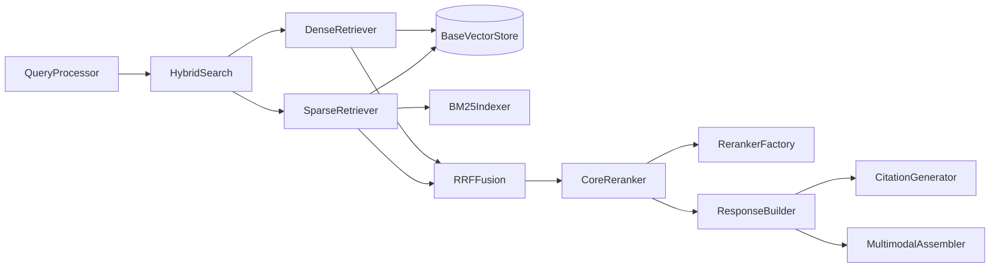

# Technical Plan: Hybrid Retrieval

| 字段 | 值 |
|---|---|
| Spec | `002-hybrid-retrieval` |
| Status | implemented |
| Components | `src/core/query_engine/{query_processor,dense_retriever,sparse_retriever,fusion,reranker,hybrid_search}.py`、`src/core/response/*`、`src/libs/reranker/*` |
| State | 无状态：每次查询独立，不缓存排序结果 |
| Rollback | 回退代码即可；不支持运行时切换融合算法，参数变更通过配置重启生效 |

## 1. 处理伪代码

```python
class HybridSearch:
    def search(self, query: str, collection: str | None = None, top_k: int | None = None):
        trace = TraceContext(trace_type="query")

        processed = self.query_processor.process(query)                     # ProcessedQuery

        dense, dense_err = self._safe(self.dense_retriever.retrieve, ...)
        sparse, sparse_err = self._safe(self.sparse_retriever.retrieve, ...)

        if dense is None and sparse is None:
            raise HybridSearchError(dense_err, sparse_err)                  # 两路都失败

        rankings = [r for r in (dense, sparse) if r is not None]
        fused = self.fusion.fuse(rankings, top_k=self.config.fusion_top_k)   # RRF，确定性

        reranked = self.reranker.rerank(fused, top_k=self.rerank_top_k)
        if reranked.used_fallback:
            logger.warning("rerank fallback: %s", reranked.fallback_reason)

        response = self.response_builder.build(query, reranked.results)
        trace.finish(); TraceCollector().collect(trace)
        return response
```

## 2. 组件交互



## 3. 查询预处理

`QueryProcessor.process(query) -> ProcessedQuery`，包含原始查询、供 BM25 使用的关键词列表、过滤条件字典。把这一步独立出来是为了让未来的 Query Rewrite / 同义词扩展只改这一层，召回实现零改动。

## 4. 双路召回

| 路径 | 依赖 | 说明 |
|---|---|---|
| Dense | `BaseVectorStore.query(embedding, top_k)` | 通过 Embedding Factory 得到查询向量；只依赖抽象接口，因此 Chroma / Qdrant / Pinecone 可互换 |
| Sparse | `BM25Indexer` + `BaseVectorStore.get_by_ids` | 先从倒排索引拿候选 id 与分数，再补齐文本与元数据 |

Sparse 之所以需要二次取回：BM25 索引只存词频统计与 `chunk_id`，文本与元数据存在向量库里。共享同一套 `chunk_id` 是两个存储能协作的前提。

并行执行使用线程池；`parallel_retrieval=False` 时顺序执行，便于在调试时稳定复现顺序。

## 5. RRF 融合

```python
def fuse(self, rankings: list[list[RetrievalResult]], top_k: int) -> list[RetrievalResult]:
    scores: dict[str, float] = {}
    seen: dict[str, RetrievalResult] = {}
    for ranking in rankings:
        for rank, item in enumerate(ranking, start=1):
            scores[item.chunk_id] = scores.get(item.chunk_id, 0.0) + 1.0 / (self.k + rank)
            seen.setdefault(item.chunk_id, item)
    ordered = sorted(scores.items(), key=lambda kv: (-kv[1], kv[0]))   # 确定性 tie-break
    return [replace(seen[cid], score=score) for cid, score in ordered[:top_k]]
```

三个设计要点：

1. **只用名次**：两路分数尺度不同，任何加权求和在分布漂移时都会失稳；RRF 对异常分数天然鲁棒。
2. **确定性**：`(-score, chunk_id)` 的排序键保证同分时按 id 稳定排列，否则回归测试会随机失败。
3. **缺失容忍**：`seen.setdefault` 让只在一路出现的文档保留下来——这正是混合检索提升召回的核心机制。

## 6. 降级编排

```text
两路成功 → 融合两路
一路异常 → 记录 Trace 错误，用另一路继续
两路异常 → 抛 HybridSearchError，消息包含两路各自的失败原因
```

`enable_dense` / `enable_sparse` 为 false 时不做「失败」处理，而是直接按单路模式运行。

## 7. 重排

`CoreReranker` 通过 `RerankerFactory` 获取后端：

| provider | 行为 |
|---|---|
| `none` | `NoneReranker`，直接返回输入顺序，`reranker_type="none"` |
| `cross_encoder` | 加载交叉编码器（默认 `cross-encoder/ms-marco-MiniLM-L6-v2`）打分重排 |
| `llm` | 按 `config/prompts/rerank.txt` 让模型给相关性排序 |

回退契约：

```python
def rerank(self, candidates, top_k) -> RerankResult:
    if not self.config.enabled or self.reranker_type == "none":
        return RerankResult(candidates[:top_k], reranker_type="none")
    try:
        scored = self.backend.rerank([...], timeout=self.config.timeout)
    except Exception as err:
        if not self.config.fallback_on_error:
            raise
        return RerankResult(candidates[:top_k], used_fallback=True,
                            fallback_reason=str(err), reranker_type=self.reranker_type,
                            original_order=candidates)
    ...
```

`original_order` 保留重排前顺序，让「重排到底有没有改善排序」可以被离线验证，而不是靠感觉。

## 8. 响应组装

- `CitationGenerator` 为每条结果生成 `Citation(index, chunk_id, source, page, score, text_snippet, metadata)`，`index` 是 1 基序号。
- `ResponseBuilder` 输出 `content`（Markdown，带 `[n]` 标记）与 `structuredContent`（citations + metadata），两者序号必须一致。
- 空结果：`is_empty=True` 并附可读说明，**不视为错误**——调用方需要区分「查不到」与「调用失败」。
- `MultimodalAssembler` 懒加载图片：只有被请求时才读文件、判 MIME、base64 编码。

## 9. 多模态容错

```text
扩展名映射（.png/.jpg/.jpeg/.gif/.webp/.bmp/.svg）→ 魔数嗅探兜底
  魔数：\x89PNG / \xff\xd8\xff / GIF87a|GIF89a / RIFF / BM
```

文件不存在、不可读、MIME 判定失败都只跳过该图片；文本结果照常返回。

## 10. Trace 打点

| 阶段 | 记录内容 |
|---|---|
| `query_processing` | 关键词数量、过滤条件 |
| `dense_retrieval` | provider、top_k、命中数、耗时 |
| `sparse_retrieval` | 索引集合、top_k、命中数、耗时 |
| `fusion` | k 值、两路输入条数、输出条数 |
| `rerank` | reranker_type、used_fallback、fallback_reason、耗时 |
| `response_build` | 结果条数、引用条数、图片条数 |

召回快照通过 `_snapshot_results` 生成（`chunk_id` / `score` / `text` / `source`），便于离线比对两次运行的排序差异。

## 11. 风险与缓解

| 风险 | 影响 | 缓解 |
|---|---|---|
| 分数尺度不可比 | 融合结果失稳 | 用 RRF，只用名次 |
| 排序非确定 | 回归测试随机失败 | 按 `chunk_id` tie-break |
| 单路故障 | 查询整体失败 | 单路降级 |
| 重排依赖模型 | 模型不可用时查询失败 | 可关闭 + 自动回退 + 标记 |
| Sparse 取不到文本 | 结果不可用 | 降级为无文本结果，不抛异常 |
| 图片缺失 | 响应组装失败 | 懒加载 + 单图跳过 |
| 融合丢弃独有文档 | 混合检索失去意义 | 只在一路出现的文档仍计分 |
| Trace 记录不全 | 无法定位质量退化 | 固定阶段名与字段 |
## 12. 验证

```bash
pytest -m unit
pytest tests/unit/test_fusion_rrf.py tests/unit/test_reranker_fallback.py -v
pytest tests/integration/test_hybrid_search.py tests/integration/test_query_trace.py -v
pytest tests/e2e/test_recall.py -v
python scripts/query.py --query "RRF 是什么" --verbose
python scripts/query.py --query "RRF 是什么" --no-rerank
```

## 13. 回滚

代码可整体回退。融合算法与重排后端在运行时不可切换，回退需要重启进程；`rerank.enabled=false` 是最轻量的降级开关，可在不改代码的情况下把链路恢复为纯融合排序。
