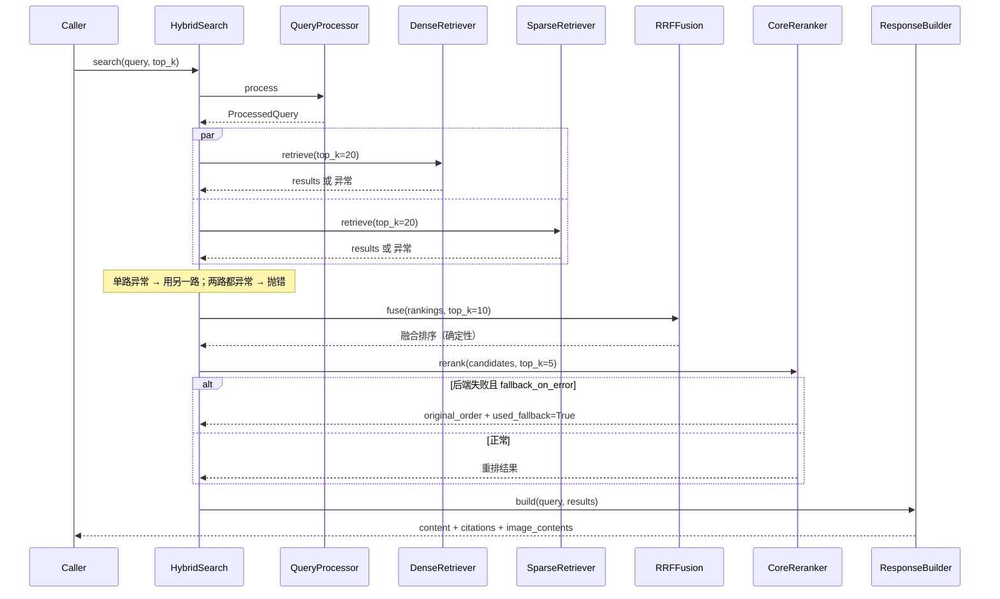

# Feature Specification: Hybrid Retrieval

| 字段 | 值 |
|---|---|
| Spec ID | `002-hybrid-retrieval` |
| Status | implemented |
| Version | 2.0.0 |
| Owner | Core query engine |
| Scope | 查询预处理、双路召回、RRF 融合、重排、引用与响应组装 |
| Related | `specs/001-ingestion-pipeline`、`specs/003-mcp-interface`、`specs/004-trace-evaluation`、`DEV_SPEC.md` §6.2 §9 |
| Evidence | `src/core/query_engine/*`、`src/core/response/*`、`src/core/types.py`、`src/libs/reranker/*`、`tests/unit/`、`tests/integration/test_hybrid_search.py`、`tests/e2e/test_recall.py` |

## 1. 背景

单一检索路径必然有盲区：向量检索对语义相近但措辞不同的查询有效，但对专有名词、代码标识符、缩写、编号不敏感；BM25 恰好相反。

把两路结果合并又带来新问题：

| 问题 | 说明 |
|---|---|
| 分数不可比 | 余弦相似度在 [-1, 1]，BM25 是无上界正数，直接加权求和会随分布漂移失稳 |
| 单路故障 | 一路超时或索引缺失不应该让整次查询失败 |
| 结果不稳定 | 相同输入两次运行顺序不同，会让回归测试随机失败 |
| 重排不可用 | 重排依赖模型，模型不可用时不应该让查询失败 |
| 结果不可追溯 | 只给文本不给来源，调用方无法核对 |

Hybrid Retrieval 的职责是把这些问题变成一组确定行为。

## 2. 目标

- 查询预处理与召回解耦，便于将来加入 Query Rewrite。
- 两路召回可并行，单路失败可降级。
- 用 RRF 融合，不要求两路分数可比。
- 融合结果确定：相同输入总是相同顺序。
- 重排可开关、可降级、可观测其是否被使用。
- 输出包含结构化引用与可选图片内容。
- 每个阶段都有 Trace 记录。

## 3. 非目标

- 不实现 Query Rewrite、同义词扩展、HyDE、多跳检索。
- 不实现学习型融合权重（不训练排序模型）。
- 不实现跨语料库联邦检索。
- 不生成最终自然语言答案。
- 不承诺在大语料下的延迟基线。

## 4. 角色与边界

| 角色 | 可以做 | 不可以做 |
|---|---|---|
| MCP 工具 / CLI | 传入查询与 `top_k`、集合过滤 | 修改召回参数 |
| `QueryProcessor` | 关键词抽取与过滤条件构造 | 访问存储 |
| `DenseRetriever` / `SparseRetriever` | 各自召回 Top-K | 修改融合逻辑 |
| `RRFFusion` | 按名次融合多路结果 | 访问存储或模型 |
| `CoreReranker` | 重排候选或声明回退 | 改变候选集合 |
| `ResponseBuilder` | 组装内容与引用 | 修改排序 |

## 5. 功能需求

### 5.1 预处理与召回

| ID | 优先级 | 需求 | 验证 |
|---|---|---|---|
| R-RET-01 | P0 | `QueryProcessor` 必须产出 `ProcessedQuery`（原始查询 + 关键词 + filters），不直接调用任何存储。 | `test_query_processor.py` |
| R-RET-02 | P0 | Dense 检索必须通过 `BaseVectorStore` 抽象执行，不直接依赖具体向量库。 | `test_dense_retriever.py`、`test_vector_store_contract.py` |
| R-RET-03 | P0 | Sparse 检索必须由 BM25 索引给出候选 id，再通过向量库 `get_by_ids` 补回文本与元数据。 | `test_sparse_retriever.py` |
| R-RET-04 | P1 | 两路召回必须支持并行执行，且可配置关闭。 | `test_hybrid_search`（集成） |
| R-RET-05 | P1 | 两路默认各取 `dense_top_k` / `sparse_top_k`（各 20）。 | 配置检查 |
| R-RET-06 | P0 | 候选文本缺失或元数据不完整时不得抛异常，必须降级为可用结果。 | `test_sparse_retriever.py` |

### 5.2 融合

| ID | 优先级 | 需求 | 验证 |
|---|---|---|---|
| R-RET-07 | P0 | 融合必须使用 RRF：`score(d) = Σ 1/(k + rank(d))`，`k` 来自 `retrieval.rrf_k`（默认 60）。 | `test_fusion_rrf.py` |
| R-RET-08 | P0 | 融合**不得**使用原始分数，只使用名次。 | `test_fusion_rrf.py` |
| R-RET-09 | P0 | 分数相同时必须按 `chunk_id` 稳定排序，保证输出确定性。 | `test_fusion_rrf.py` |
| R-RET-10 | P0 | 只出现在一路的文档仍然参与计分，不得被丢弃。 | `test_fusion_rrf.py` |
| R-RET-11 | P1 | 融合后取 `fusion_top_k`（默认 10）进入重排。 | 配置检查 |
| R-RET-12 | P1 | 空输入（任一路或两路为空）必须返回空列表而不是抛异常。 | `test_fusion_rrf.py` |

### 5.3 降级

| ID | 优先级 | 需求 | 验证 |
|---|---|---|---|
| R-RET-13 | P0 | 单路召回失败时，必须用成功的另一路继续，并在 Trace 中记录失败原因。 | 集成用例 |
| R-RET-14 | P0 | 两路都失败时才抛出明确错误，且错误信息包含两条路径各自的失败原因。 | 集成用例 |
| R-RET-15 | P1 | `enable_dense` / `enable_sparse` 为 false 时按单路模式运行而不报错。 | 单元用例 |

### 5.4 重排

| ID | 优先级 | 需求 | 验证 |
|---|---|---|---|
| R-RET-16 | P0 | `rerank.provider: none` 时必须直接返回融合顺序，不加载任何模型。 | `test_reranker_factory.py` |
| R-RET-17 | P0 | 重排后端异常或超时且 `fallback_on_error=True` 时，必须返回原始顺序并置 `used_fallback=True` 与 `fallback_reason`。 | `test_reranker_fallback.py` |
| R-RET-18 | P0 | `RerankResult.original_order` 必须保留重排前的顺序，供对比与调试。 | 契约检查 |
| R-RET-19 | P1 | 重排超时由 `RerankConfig.timeout`（默认 30s）控制。 | 契约检查 |
| R-RET-20 | P1 | 重排后取 `rerank.top_k`（默认 5）作为最终结果。 | `test_reranker_fallback.py` |
| R-RET-21 | P1 | 重排后端必须通过 `RerankerFactory` 获取，业务层不直接实例化实现。 | `test_reranker_factory.py` |

### 5.5 响应组装

| ID | 优先级 | 需求 | 验证 |
|---|---|---|---|
| R-RET-22 | P0 | 引用必须包含 `index`、`chunk_id`、`source`、`score`、`text_snippet`，可选 `page` 与 `metadata`。 | `test_response_builder.py` |
| R-RET-23 | P0 | `content` 为带 `[1] [2]` 标记的 Markdown，且标记与 citations 的 `index` 一致。 | `test_response_builder.py` |
| R-RET-24 | P0 | 空结果必须返回 `is_empty=True` 与可读说明，**不是**错误。 | `test_response_builder.py` |
| R-RET-25 | P1 | 命中含图片的 chunk 时组装 `ImageContent`；图片缺失只跳过图片，不失败。 | `test_multimodal_assembler.py` |
| R-RET-26 | P1 | MIME 类型必须先按扩展名映射，再用魔数嗅探兜底。 | `test_multimodal_assembler.py` |
| R-RET-27 | P2 | `metadata` 至少包含 `query` 与 `result_count`。 | 契约检查 |

### 5.6 可观测性

| ID | 优先级 | 需求 | 验证 |
|---|---|---|---|
| R-RET-28 | P0 | 查询链路必须记录阶段：`query_processing`、`dense_retrieval`、`sparse_retrieval`、`fusion`、`rerank`、`response_build`。 | `tests/integration/test_query_trace.py` |
| R-RET-29 | P1 | 融合与重排阶段必须记录输入条数、输出条数与是否使用回退。 | Trace 检查 |
| R-RET-30 | P1 | 召回结果快照（`chunk_id` / `score` / 来源）必须可写入 Trace 供排查。 | Trace 检查 |

## 6. 对外契约

```python
@dataclass
class RetrievalResult:
    chunk_id: str
    score: float
    text: str | None
    metadata: dict

@dataclass
class ProcessedQuery:
    query: str
    keywords: list[str]
    filters: dict

HybridSearchConfig(dense_top_k=20, sparse_top_k=20, fusion_top_k=10,
                   enable_dense=True, enable_sparse=True, parallel_retrieval=True)

RRFFusion(k=60).fuse(rankings: list[list[RetrievalResult]], top_k: int) -> list[RetrievalResult]

RerankConfig(enabled=True, top_k=5, timeout=30.0, fallback_on_error=True)
RerankResult(results, used_fallback, fallback_reason, reranker_type, original_order)

MCPToolResponse(content, citations, metadata, is_empty, image_contents)
Citation(index, chunk_id, source, page, score, text_snippet, metadata)
```

## 7. 默认参数

| 参数 | 值 | 位置 |
|---|---|---|
| `dense_top_k` | 20 | `retrieval.dense_top_k` |
| `sparse_top_k` | 20 | `retrieval.sparse_top_k` |
| `fusion_top_k` | 10 | `retrieval.fusion_top_k` |
| `rrf_k` | 60 | `retrieval.rrf_k` |
| `rerank.enabled` | false | `rerank.enabled` |
| `rerank.provider` | none | `rerank.provider` |
| `rerank.model` | `cross-encoder/ms-marco-MiniLM-L6-v2` | `rerank.model` |
| `rerank.top_k` | 5 | `rerank.top_k` |
| 单次工具默认 `top_k` | 5 | `query_knowledge_hub` Schema |

## 8. 时序



## 9. 失败行为

| 场景 | 行为 |
|---|---|
| 查询为空字符串 | 返回空结果（`is_empty=True`），不抛异常 |
| Dense 路径异常 | 记录 Trace 错误，使用 Sparse 结果继续 |
| Sparse 路径异常 | 记录 Trace 错误，使用 Dense 结果继续 |
| 两路都异常 | 抛出错误，消息包含两条路径的失败原因 |
| BM25 索引不存在 | 视为 Sparse 路径失败，走单路降级 |
| 候选 chunk 取不到文本 | 该条结果降级为无文本，不抛异常 |
| 融合输入为空 | 返回空列表 |
| 分数相同 | 按 `chunk_id` 稳定排序 |
| 重排后端超时 | 回退原始顺序，`used_fallback=True`，`fallback_reason="timeout"` |
| 重排后端异常 | 同上，`fallback_reason` 记录异常摘要 |
| `rerank.provider: none` | 直接返回融合顺序，`reranker_type="none"` |
| 图片文件缺失 | 跳过该图片，文本结果正常返回 |
| Trace 落盘失败 | 记录日志，查询结果不受影响 |

## 10. 可观测性

- Trace 阶段耗时可用于回答「慢在召回还是慢在重排」。
- 融合阶段记录两路输入条数与融合输出条数，可判断是否有一路实际为空。
- 重排阶段记录 `reranker_type`、`used_fallback`、`fallback_reason`，不靠日志猜。
- 召回快照（`chunk_id` / 分数 / 来源）可落到 Trace，用于离线比对排序变化。
- Dashboard「查询追踪」页消费这些 Trace 渲染瀑布。

## 11. 验收标准

| AC | 内容 | 方式 |
|---|---|---|
| AC1 | RRF 只使用名次，分数相同按 `chunk_id` 稳定排序 | `pytest tests/unit/test_fusion_rrf.py -v` |
| AC2 | 只在单路出现的文档仍被计分保留 | `pytest tests/unit/test_fusion_rrf.py -v` |
| AC3 | 重排关闭时返回融合顺序 | `pytest tests/unit/test_reranker_factory.py -v` |
| AC4 | 重排失败回退并标记 `used_fallback` / `fallback_reason` | `pytest tests/unit/test_reranker_fallback.py -v` |
| AC5 | 引用结构与 Markdown 标记一致 | `pytest tests/unit/test_response_builder.py -v` |
| AC6 | 图像 MIME 判定与缺失容错 | `pytest tests/unit/test_multimodal_assembler.py -v` |
| AC7 | 双路编排与单路降级 | `pytest tests/integration/test_hybrid_search.py -v` |
| AC8 | 查询链路产生完整 Trace | `pytest tests/integration/test_query_trace.py -v` |
| AC9 | 召回回归可执行 | `pytest tests/e2e/test_recall.py -v -m e2e` |
| AC10 | 端到端查询可复现 | `python scripts/query.py --query "RRF 是什么" --verbose` |

## 12. 需求追踪

| 需求 | 计划 | 任务 | 验证 |
|---|---|---|---|
| R-RET-01 | Plan §3 | T-RET-01 | `test_query_processor.py` |
| R-RET-02 | Plan §4 | T-RET-02 | `test_dense_retriever.py` |
| R-RET-03 | Plan §4 | T-RET-03 | `test_sparse_retriever.py` |
| R-RET-04 | Plan §4 | T-RET-04 | 集成用例 |
| R-RET-06 | Plan §4 | T-RET-05 | `test_sparse_retriever.py` |
| R-RET-07 | Plan §5 | T-RET-06 | `test_fusion_rrf.py` |
| R-RET-08 | Plan §5 | T-RET-07 | `test_fusion_rrf.py` |
| R-RET-09 | Plan §5 | T-RET-08 | `test_fusion_rrf.py` |
| R-RET-10 | Plan §5 | T-RET-09 | `test_fusion_rrf.py` |
| R-RET-12 | Plan §5 | T-RET-10 | `test_fusion_rrf.py` |
| R-RET-13 | Plan §6 | T-RET-11 | 集成用例 |
| R-RET-14 | Plan §6 | T-RET-12 | 集成用例 |
| R-RET-15 | Plan §6 | T-RET-13 | 单元用例 |
| R-RET-16 | Plan §7 | T-RET-14 | `test_reranker_factory.py` |
| R-RET-17 | Plan §7 | T-RET-15 | `test_reranker_fallback.py` |
| R-RET-18 | Plan §7 | T-RET-16 | 契约检查 |
| R-RET-20 | Plan §7 | T-RET-17 | `test_reranker_fallback.py` |
| R-RET-21 | Plan §7 | T-RET-18 | `test_reranker_factory.py` |
| R-RET-22 | Plan §8 | T-RET-19 | `test_response_builder.py` |
| R-RET-23 | Plan §8 | T-RET-20 | `test_response_builder.py` |
| R-RET-24 | Plan §8 | T-RET-21 | `test_response_builder.py` |
| R-RET-25 | Plan §9 | T-RET-22 | `test_multimodal_assembler.py` |
| R-RET-26 | Plan §9 | T-RET-23 | `test_multimodal_assembler.py` |
| R-RET-28 | Plan §10 | T-RET-24 | `test_query_trace.py` |
| R-RET-29 | Plan §10 | T-RET-25 | Trace 检查 |
| R-RET-30 | Plan §10 | T-RET-26 | Trace 检查 |
