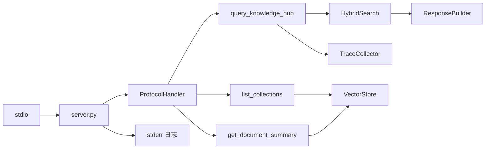

# Technical Plan: MCP Interface

| 字段 | 值 |
|---|---|
| Spec | `003-mcp-interface` |
| Status | implemented |
| Components | `src/mcp_server/{server,protocol_handler}.py`、`src/mcp_server/tools/*`、`main.py` |
| State | 工具注册表在内存中，启动时构建；无运行时状态 |
| Rollback | 回退代码即可；工具契约向后兼容，删除工具需先确认无客户端依赖 |

## 1. 启动伪代码

```python
def main():
    _redirect_all_loggers_to_stderr()     # stdout 只能给 JSON-RPC
    _preload_heavy_imports()              # 必须在 anyio 起线程之前

    handler = ProtocolHandler(server_name="modular-rag-mcp-server", server_version="0.1.0")
    register_query_knowledge_hub(handler)
    register_list_collections(handler)
    register_get_document_summary(handler)

    server = create_mcp_server(handler)
    asyncio.run(server.run_stdio())
```

## 2. 组件交互



## 3. stdout 纯净与导入死锁

### 3.1 日志重定向

```python
def _redirect_all_loggers_to_stderr() -> None:
    root = logging.getLogger()
    stderr_handler = logging.StreamHandler(sys.stderr)
    stderr_handler.setFormatter(logging.Formatter("%(asctime)s %(levelname)s %(name)s %(message)s"))
    for handler in root.handlers[:]:                    # 移除指向 stdout 的 stream handler
        if isinstance(handler, logging.StreamHandler) and not isinstance(handler, logging.FileHandler):
            root.removeHandler(handler)
    root.addHandler(stderr_handler)
```

任何第三方库默认往 stdout 打日志的行为都会在启动时被纠正。这是 MCP over stdio 的硬约束：stdout 是协议通道，不是控制台。

### 3.2 预加载重依赖

```python
def _preload_heavy_imports() -> None:
    import chromadb          # 连带 onnxruntime / numpy / sqlite3 C 扩展
    # 其它重依赖...
```

原因：SDK 基于 anyio，在后台线程做 stdin/stdout I/O。工具处理器通过 `asyncio.to_thread` 在 worker 线程执行，如果该线程此时**首次**执行 `import chromadb`，它会与正在读 stdin 的线程争抢 Python 全局导入锁，导致进程假死。在主线程（I/O 线程尚未启动时）预加载后，worker 线程的 `import` 只命中 `sys.modules` 并立即返回。

这个问题的排查成本很高：现象是「调用某个工具时进程卡住」，没有异常、没有堆栈，用普通日志看不到原因。

## 4. 工具注册

```python
@dataclass
class ToolDefinition:
    name: str
    description: str
    input_schema: dict[str, Any]
    handler: Callable[..., Any]

@dataclass
class ProtocolHandler:
    server_name: str
    server_version: str
    tools: dict[str, ToolDefinition] = field(default_factory=dict)
```

三个工具体现能力递进关系：`list_collections` 发现可用集合 → `query_knowledge_hub` 检索 → `get_document_summary` 深入某个文档。工具描述里明确写出这个顺序，让模型知道怎么串联。

`input_schema` 显式书写而不是从签名推断，因为 MCP 客户端直接消费这段 Schema：字段描述、`default`、`minimum` 都是对外契约的一部分。

## 5. 协议处理

| 阶段 | 行为 |
|---|---|
| `initialize` | 返回服务名、版本与能力声明 |
| `tools/list` | 返回全部 `ToolDefinition` 的 `name` / `description` / `inputSchema` |
| `tools/call` | 查表 → 参数校验 → `asyncio.to_thread(handler, args)` → 组装 Content |
| 未知方法 | `-32601` |

参数校验在调用处理器之前完成，避免把「缺参数」这种调用方错误变成工具内部的 500。

## 6. 返回值组装

- `TextContent`：Markdown 结果，带 `[n]` 引用标记，面向模型阅读。
- `ImageContent`：base64 + `mimeType`，面向多模态客户端。
- `structuredContent`：`citations` 与 `metadata`，面向程序化消费。

同时提供文本与结构化字段，是为了避免调用方为了拿引用去正则解析 Markdown——那会让引用格式成为隐式契约。

## 7. 工具用线程池执行

检索是同步阻塞调用（向量库查询、BM25 查询、文件读取）。直接在 async 函数里调用会阻塞事件循环，导致该进程在检索期间无法响应其它 MCP 消息。因此统一用 `asyncio.to_thread(...)` 下沉到线程池。

## 8. 错误语义

```text
-32700 PARSE_ERROR      JSON 解析失败
-32600 INVALID_REQUEST  请求结构非法
-32601 METHOD_NOT_FOUND 未知方法或未知工具
-32602 INVALID_PARAMS   参数缺失或类型错误
-32603 INTERNAL_ERROR   处理器内部异常（堆栈只进 stderr）
```

「检索无结果」**不**使用错误码：它是合法的业务结果，用 `is_empty=True` 表达，让客户端能区分「没有匹配」与「服务坏了」。

## 9. 风险与缓解

| 风险 | 影响 | 缓解 |
|---|---|---|
| 日志污染 stdout | 协议解析失败 | 启动时重定向；单测覆盖 |
| worker 线程导入死锁 | 调用卡死无异常 | 主线程预加载重依赖 |
| Schema 与实现不一致 | 客户端调用被拒 | Schema 显式声明 + 契约测试 |
| 未捕获异常 | 客户端收到半成品 | 统一映射为 `-32603` |
| 空结果被当成错误 | 客户端误报故障 | `is_empty=True` 正常返回 |
| 阻塞事件循环 | 并发调用无响应 | `asyncio.to_thread` |
| 工具描述含糊 | 模型不会串联工具 | 描述里写明使用顺序 |
| 工具契约漂移 | 下游客户端破坏 | 契约变更必须在 spec 里显式声明 |

## 10. 验证

```bash
pytest -m unit
pytest tests/unit/test_protocol_handler.py tests/unit/test_list_collections.py \
       tests/unit/test_get_document_summary.py tests/unit/test_smoke_imports.py -v
pytest tests/integration/test_mcp_server.py -v
pytest tests/e2e/test_mcp_client.py -v
python main.py    # 配合支持 MCP 的客户端手工验证
```

## 11. 回滚

代码可整体回退。工具契约变更（改名、改必需参数、改返回结构）属于破坏性变更，回滚前必须确认没有客户端已依赖新契约；仅增加可选参数是向后兼容的。
