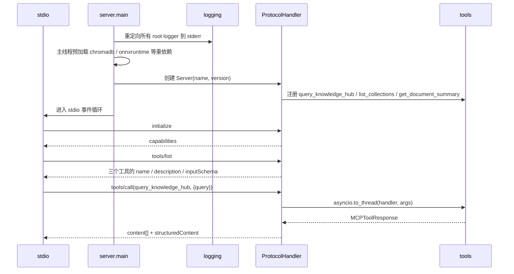

# Feature Specification: MCP Interface

| 字段 | 值 |
|---|---|
| Spec ID | `003-mcp-interface` |
| Status | implemented |
| Version | 2.0.0 |
| Owner | MCP server layer |
| Scope | MCP Server 启动、工具注册与 Schema、JSON-RPC 错误语义、返回值形态 |
| Related | `specs/002-hybrid-retrieval`、`specs/004-trace-evaluation`、`DEV_SPEC.md` §5.4 §10 |
| Evidence | `src/mcp_server/{server,protocol_handler}.py`、`src/mcp_server/tools/*`、`main.py`、`tests/unit/test_protocol_handler.py`、`tests/integration/test_mcp_server.py`、`tests/e2e/test_mcp_client.py` |

## 1. 背景

MCP 客户端（编辑器、桌面 AI 应用、自研 Agent）会直接消费这个服务的工具 Schema 与返回值。因此这里的每一处都是对外契约，而不是内部实现细节。

两个容易被忽视、但一旦踩到就会致命的约束：

| 约束 | 违反的后果 |
|---|---|
| stdout 只能输出 JSON-RPC | 任何一行日志都会破坏协议流，客户端直接解析失败 |
| 工具处理函数运行在 SDK 的 worker 线程中 | 此时首次导入重依赖会与 stdin 读线程争抢全局导入锁，进程假死 |

除此之外，工具契约的稳定性、错误语义的规范性、空结果与失败的区别，都会影响所有下游客户端。

## 2. 目标

- 通过官方 MCP SDK 提供稳定、显式声明的工具契约。
- 保证 stdout 纯净：任何日志都不得进入协议流。
- 避免 worker 线程导入死锁。
- 用标准 JSON-RPC 错误码表达失败，而不是把异常文本混进正常结果。
- 明确区分「检索无结果」与「调用失败」。
- 同时返回人类可读文本与机器可消费的结构化字段。
- 支持命中图片时的多模态返回。

## 3. 非目标

- 不实现 HTTP / SSE / WebSocket transport（当前只有 stdio）。
- 不实现鉴权、配额与多租户隔离。
- 不实现工具的动态发现与热插拔（工具集在启动时固定）。
- 不实现长时任务的进度上报与取消。
- 不承诺并发调用下的吞吐。

## 4. 角色与边界

| 角色 | 可以做 | 不可以做 |
|---|---|---|
| MCP Client | 初始化协商、`tools/list`、`tools/call` | 修改服务端工具注册表 |
| `ProtocolHandler` | 注册工具、校验 Schema、映射错误码 | 实现检索算法 |
| 工具处理器 | 参数校验、调用检索、组装结果 | 输出到 stdout |
| `logger` / `TraceCollector` | 写 stderr 与文件 | 写 stdout |

## 5. 功能需求

### 5.1 启动与流约束

| ID | 优先级 | 需求 | 验证 |
|---|---|---|---|
| R-MCP-01 | P0 | 必须使用官方 MCP SDK 与 stdio transport。 | `test_mcp_server.py` |
| R-MCP-02 | P0 | 启动时必须把所有 root logger 的 stream handler 重定向到 stderr。 | `test_mcp_server.py` |
| R-MCP-03 | P0 | 必须在 anyio 启动 I/O 线程之前在主线程预加载重依赖（chromadb 等）。 | `test_smoke_imports.py` + 代码审查 |
| R-MCP-04 | P1 | 服务名与版本必须显式声明（`modular-rag-mcp-server` / `0.1.0`）。 | `test_mcp_server.py` |
| R-MCP-05 | P0 | 任何工具处理器都不得向 stdout 写入内容。 | 代码审查 + `test_mcp_server.py` |

### 5.2 工具契约

| ID | 优先级 | 需求 | 验证 |
|---|---|---|---|
| R-MCP-06 | P0 | 必须提供 `query_knowledge_hub`，`query` 为必需参数，`top_k` 默认 5 且最小 1，`collection` 可选。 | `test_protocol_handler.py` |
| R-MCP-07 | P0 | 必须提供 `list_collections`，`include_stats` 默认 true。 | `test_list_collections.py` |
| R-MCP-08 | P0 | 必须提供 `get_document_summary`，`doc_id` 为必需参数，支持完整 id 或哈希片段。 | `test_get_document_summary.py` |
| R-MCP-09 | P0 | `input_schema` 必须显式书写为 JSON Schema，不从函数签名推断。 | `test_protocol_handler.py` |
| R-MCP-10 | P0 | 工具描述必须说明参数含义与使用时机（例如先 `list_collections` 再查询）。 | 描述审查 |
| R-MCP-11 | P1 | 工具注册表以 `dict[str, ToolDefinition]` 存放，重名注册必须被拒绝。 | `test_protocol_handler.py` |

### 5.3 协议与错误

| ID | 优先级 | 需求 | 验证 |
|---|---|---|---|
| R-MCP-12 | P0 | 必须支持 `initialize` 能力协商与 `tools/list`、`tools/call`。 | `test_protocol_handler.py` |
| R-MCP-13 | P0 | 非法 JSON → `-32700`；非法请求结构 → `-32600`。 | `test_protocol_handler.py` |
| R-MCP-14 | P0 | 未知工具/方法 → `-32601`，且不执行任何检索。 | `test_protocol_handler.py` |
| R-MCP-15 | P0 | 缺少必需参数或类型错误 → `-32602`，不得抛出未捕获的 Python 异常。 | `test_protocol_handler.py` |
| R-MCP-16 | P0 | 工具内部未预期异常 → `-32603`，详细堆栈只写 stderr 日志，不返回给客户端。 | `test_mcp_server.py` |

### 5.4 返回值

| ID | 优先级 | 需求 | 验证 |
|---|---|---|---|
| R-MCP-17 | P0 | 返回值必须是 MCP `Content` 数组（`TextContent` / `ImageContent`）。 | `test_mcp_server.py` |
| R-MCP-18 | P0 | 检索无结果必须返回 `is_empty=True` 与可读说明，属于**正常返回**而非错误。 | `test_response_builder.py` |
| R-MCP-19 | P1 | 结构化引用必须放在 `structuredContent`，避免调用方解析 Markdown。 | `test_response_builder.py` |
| R-MCP-20 | P1 | 命中含图片的 chunk 时，`ImageContent` 的 `mimeType` 必须正确；图片缺失只跳过。 | `test_multimodal_assembler.py` |
| R-MCP-21 | P2 | 工具执行必须在实际调用链路上产生查询 Trace。 | `test_query_trace.py` |

### 5.5 并发

| ID | 优先级 | 需求 | 验证 |
|---|---|---|---|
| R-MCP-22 | P1 | 工具处理器必须通过 `asyncio.to_thread` 执行阻塞型检索，不阻塞事件循环。 | 代码审查 |
| R-MCP-23 | P2 | 并发调用同一集合只读检索不得相互干扰。 | 集成用例 |

## 6. 工具契约

### 6.1 `query_knowledge_hub`

```json
{
  "type": "object",
  "properties": {
    "query":    { "type": "string", "description": "The search query or question to find relevant documents for." },
    "top_k":    { "type": "integer", "description": "Maximum number of results to return.", "default": 5, "minimum": 1 },
    "collection": { "type": "string", "description": "Limit search to a specific collection." }
  },
  "required": ["query"]
}
```

行为：`HybridSearch`（Dense + Sparse + RRF）→ 可选重排 → `ResponseBuilder` 组装带引用结果。

### 6.2 `list_collections`

```json
{
  "type": "object",
  "properties": {
    "include_stats": { "type": "boolean", "description": "Whether to include statistics (document count) for each collection.", "default": true }
  },
  "required": []
}
```

行为：返回集合名列表与（可选）文档数；用于让客户端在查询前发现可用集合。

### 6.3 `get_document_summary`

```json
{
  "type": "object",
  "properties": {
    "doc_id": { "type": "string", "description": "The document ID to retrieve summary for. Can be full doc_id (e.g., 'doc_abc123') or the hash portion." },
    "collection": { "type": "string", "description": "Collection name to search in. If not specified, searches the default collection." }
  },
  "required": ["doc_id"]
}
```

行为：返回标题、摘要、标签、来源路径与 chunk 数。

## 7. 返回结构

```text
content:
  [ { "type": "text",  "text": "<Markdown，含 [1] [2] 引用标记>" },
    { "type": "image", "data": "<base64>", "mimeType": "image/png" } ]   # 命中图片时

structuredContent:
  { "citations": [ { "index": 1, "chunk_id": "...", "source": "...",
                     "score": 0.83, "text_snippet": "...", "page": null } ],
    "metadata":  { "query": "...", "result_count": 5 } }
```

## 8. 启动时序



## 9. 失败行为

| 场景 | 行为 |
|---|---|
| stdout 被日志污染 | 属于实现缺陷；启动时重定向保证不发生；单测覆盖 |
| worker 线程首次导入重依赖 | 启动前预加载，避免导入锁死锁 |
| 非法 JSON | `-32700` |
| 请求结构不符合 JSON-RPC | `-32600` |
| 未知工具名 | `-32601`，不执行检索 |
| 缺少 `query` | `-32602` |
| `top_k` 小数或小于 1 | `-32602`（Schema `minimum: 1`，类型 integer） |
| 指定了不存在的 collection | 返回空结果（`is_empty=True`），不是错误 |
| 检索无结果 | 正常返回，附「未找到相关内容」说明 |
| 索引文件损坏或缺失 | `-32603`，堆栈写 stderr |
| 图片文件缺失 | 跳过图片，文本结果正常返回 |
| 客户端提前断开 | 进程退出，不做额外清理假设 |

## 10. 可观测性

- stderr 结构化日志：启动信息、工具调用、异常堆栈。
- `logs/traces.jsonl`：工具调用触发的查询 Trace。
- Dashboard「查询追踪」页可验证 MCP 调用产生的 Trace 与 CLI 调用结构一致。
- 禁止在 stdout 出现任何非协议内容，这是可被自动检查的约束。

## 11. 验收标准

| AC | 内容 | 方式 |
|---|---|---|
| AC1 | 三个工具的 Schema 与必需参数正确 | `pytest tests/unit/test_protocol_handler.py -v` |
| AC2 | 错误码映射覆盖 5 种标准错误 | `pytest tests/unit/test_protocol_handler.py -v` |
| AC3 | 未知工具不触发检索 | `pytest tests/unit/test_protocol_handler.py -v` |
| AC4 | 重依赖在主线程预加载，避免死锁 | `pytest tests/unit/test_smoke_imports.py -v` |
| AC5 | 集成环境下 Server 可初始化并列出工具 | `pytest tests/integration/test_mcp_server.py -v` |
| AC6 | MCP 客户端模拟调用可拿到结果与引用 | `pytest tests/e2e/test_mcp_client.py -v -m e2e` |
| AC7 | 手动接入客户端可用 | `python main.py`（配合支持 MCP 的客户端） |

## 12. 需求追踪

| 需求 | 计划 | 任务 | 验证 |
|---|---|---|---|
| R-MCP-01 | Plan §3 | T-MCP-01 | `test_mcp_server.py` |
| R-MCP-02 | Plan §3 | T-MCP-02 | `test_mcp_server.py` |
| R-MCP-03 | Plan §3 | T-MCP-03 | `test_smoke_imports.py` |
| R-MCP-04 | Plan §3 | T-MCP-04 | `test_mcp_server.py` |
| R-MCP-06 | Plan §4 | T-MCP-05 | `test_protocol_handler.py` |
| R-MCP-07 | Plan §4 | T-MCP-06 | `test_list_collections.py` |
| R-MCP-08 | Plan §4 | T-MCP-07 | `test_get_document_summary.py` |
| R-MCP-09 | Plan §4 | T-MCP-08 | `test_protocol_handler.py` |
| R-MCP-11 | Plan §4 | T-MCP-09 | `test_protocol_handler.py` |
| R-MCP-12 | Plan §5 | T-MCP-10 | `test_protocol_handler.py` |
| R-MCP-13 | Plan §5 | T-MCP-11 | `test_protocol_handler.py` |
| R-MCP-14 | Plan §5 | T-MCP-12 | `test_protocol_handler.py` |
| R-MCP-15 | Plan §5 | T-MCP-13 | `test_protocol_handler.py` |
| R-MCP-16 | Plan §5 | T-MCP-14 | `test_mcp_server.py` |
| R-MCP-17 | Plan §6 | T-MCP-15 | `test_mcp_server.py` |
| R-MCP-18 | Plan §6 | T-MCP-16 | `test_response_builder.py` |
| R-MCP-19 | Plan §6 | T-MCP-17 | `test_response_builder.py` |
| R-MCP-20 | Plan §6 | T-MCP-18 | `test_multimodal_assembler.py` |
| R-MCP-21 | Plan §7 | T-MCP-19 | `test_query_trace.py` |
| R-MCP-22 | Plan §8 | T-MCP-20 | 代码审查 |
