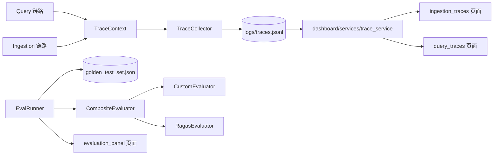

# Technical Plan: Trace and Evaluation

| 字段 | 值 |
|---|---|
| Spec | `004-trace-evaluation` |
| Status | implemented |
| Components | `src/core/trace/*`、`src/observability/logger.py`、`src/observability/evaluation/*`、`src/observability/dashboard/*`、`src/libs/evaluator/*` |
| State | Trace 在本地 JSON Lines；评估结果由 CLI 输出；Dashboard 无持久化状态 |
| Rollback | 回退代码即可；Trace 文件与评估产物是运行期数据，可直接重建 |

## 1. 追踪伪代码

```python
trace = TraceContext(trace_type="query")

with trace.stage_timer("dense_retrieval"):
    results = dense.retrieve(...)
trace.record_stage("dense_retrieval", {"provider": "chroma", "top_k": 20, "hits": len(results)})

trace.record_stage("fusion", {"k": 60, "inputs": [len(dense), len(sparse)], "outputs": len(fused)})
trace.finish()
TraceCollector().collect(trace)      # 写盘失败只记日志
```

## 2. 组件交互



## 3. TraceContext

- `trace_id = uuid4()`：一次请求一个 id，便于在日志与文件中交叉定位。
- `started_at / finished_at`：ISO-8601 UTC 字符串，跨时区可读。
- `stages: list[dict]`：有序，顺序即执行顺序，Dashboard 直接按序渲染瀑布。
- 耗时用 `time.monotonic()`：系统时间被 NTP 校正或手动修改时，`time.time()` 会出现负值或异常放大，而单调时钟不会。
- `stage_timer()` 上下文管理器：进入记录起始单调时间，退出时计算差值并 `record_stage`。手写 `t0/t1` 容易出现「异常路径忘记记时」的遗漏。
- `finish()` 幂等；`to_dict()` 直接给出可 `json.dumps` 的结构。

## 4. TraceCollector

```python
def collect(self, trace: TraceContext) -> None:
    if trace.finished_at is None:
        trace.finish()                      # 保证落盘数据总有耗时
    line = json.dumps(trace.to_dict(), ensure_ascii=False)
    try:
        with self._path.open("a", encoding="utf-8") as fh:
            fh.write(line + "\n")
    except OSError:
        logger.exception("Failed to write trace %s", trace.trace_id)
```

两条设计决定：

1. **追加写 + 一行一条**：写入是 O(1) 追加，不需要读改写；Dashboard 可以增量消费，不需要解析整个文件。
2. **异常不外抛**：观测性不能成为可用性的单点。磁盘满、权限错误都不应该让用户的检索失败。

`ensure_ascii=False` 让中文内容保持可读，便于直接 `tail` 排查。

## 5. 日志

`src/observability/logger.py` 提供 `get_logger(__name__)`，支持结构化（JSON Lines）输出。运行期排查用日志，结构化执行解释用 Trace，两者职责分开：

| 用途 | 载体 |
|---|---|
| 运行期排错、异常堆栈 | stderr 日志 |
| 一次请求的完整执行解释 | `logs/traces.jsonl` |
| 长期质量对比 | 评估报告 |

## 6. 阶段打点位置

| trace_type | 打点位置 |
|---|---|
| `ingestion` | `IngestionPipeline` 的每个阶段进入/退出 |
| `query` | `HybridSearch` 的预处理、两路召回、融合、重排、响应组装 |

阶段名作为对外可读的诊断接口必须稳定：改名等于让所有历史 Trace 与 Dashboard 图表失效。

## 7. Dashboard

六个页面 + 三个服务：

| 页面 | 数据来源 |
|---|---|
| `overview` | 集合统计 + 最近 Trace 摘要 |
| `data_browser` | 向量库 / 索引内容浏览 |
| `ingestion_manager` | 触发摄取、查看文档列表、删除文档 |
| `ingestion_traces` | `traces.jsonl` 中 `trace_type="ingestion"` 的瀑布 |
| `query_traces` | `traces.jsonl` 中 `trace_type="query"` 的瀑布 |
| `evaluation_panel` | Golden Set 与评估结果 |

| 服务 | 职责 |
|---|---|
| `config_service` | 读取 `settings.yaml` 并暴露给页面 |
| `data_service` | 只读访问向量库与 BM25 索引 |
| `trace_service` | 读取 JSONL 并按 `trace_type` 分流 |

约束：Dashboard 只读业务数据，唯一允许的写操作是通过 `DocumentManager` 删除文档。这条约束让 Dashboard 不可能成为第二个真相来源。

## 8. 评估器

### 8.1 自定义评估器

`CustomEvaluator` 只做纯计算，不需要任何外部服务：`hit_rate`（期望 chunk 是否出现在结果中）与 `mrr`（期望 chunk 排名的倒数均值）。这让 CI 可以在没有模型 Key 的情况下验证评估链路本身可用。

### 8.2 Ragas 评估器

`RagasEvaluator` 封装 ragas 的 LLM-as-Judge 指标：`faithfulness`、`answer_relevancy`、`context_precision`。采用延迟导入（`_import_ragas()`），未安装时抛出带 `pip install ragas datasets` 提示的 `ImportError`，而不是在模块导入期就崩掉所有其它功能。

### 8.3 组合评估器

```python
def evaluate(self, **kwargs) -> dict[str, float]:
    merged = {}
    for evaluator in self.evaluators:
        try:
            metrics = evaluator.evaluate(**kwargs)
        except Exception as err:
            logger.exception("evaluator failed: %s", evaluator)
            continue                              # 部分失败不影响其余
        for key, value in metrics.items():
            if key in merged:
                logger.warning("metric %s overwritten by %s", key, evaluator)
            merged[key] = value                   # 后者覆盖，但有警告
    return merged
```

「后者覆盖但警告」是刻意的：完全拒绝冲突会让组合不灵活，静默覆盖会让指标含义变得不可预测。

## 9. Golden Set 与回归

```python
@dataclass
class GoldenTestCase:
    query: str
    expected_chunk_ids: list[str] = field(default_factory=list)
    expected_sources: list[str] = field(default_factory=list)
    reference_answer: str | None = None
```

`EvalRunner` 流程：读文件 → 逐条 `HybridSearch` → 可选生成答案 → 调用评估器 → 输出 `EvalReport`（含逐条明细）。

关键行为：`expected_chunk_ids` 为空时**优雅跳过** IR 指标。原因是当前 Golden Set 的期望 id 尚未补齐（见 §11 已知局限），如果此时报错或直接给 0 分，整个评估会变成噪声——无法区分「检索失败」和「根本没给标准答案」。

## 10. 测试标记

| marker | 用途 |
|---|---|
| `unit` | 快速、无外部依赖，CI 执行 |
| `integration` | 组件边界与存储适配 |
| `e2e` | 完整链路 |
| `llm` | 需要真实模型 Key，默认排除 |
| `slow` | 不宜每次本地编辑运行 |

CI 只跑 `pytest -m unit` 与 `ruff check .`：保证 PR 上的失败一定是代码问题，而不是额度问题或网络问题。

## 11. 风险与缓解

| 风险 | 影响 | 缓解 |
|---|---|---|
| Trace 缺少结束时间 | 耗时统计失真 | `collect()` 自动补 `finish()` |
| 用墙钟计时 | 时间跳变导致异常耗时 | 单调时钟 |
| 写盘失败上抛 | 用户请求被观测性拖垮 | 捕获 `OSError` 只记日志 |
| 阶段名漂移 | 历史 Trace 与 Dashboard 图表失效 | 阶段名视为对外契约 |
| Ragas 未安装 | 模块导入期崩溃 | 延迟导入 + 明确提示 |
| 组合评估器静默冲突 | 指标含义不可预测 | 冲突时警告 |
| 子评估器失败中断整批 | 评估不可用 | 单个失败只记日志 |
| Golden Set 缺标准答案 | 指标无意义 | 优雅跳过 IR 指标，并在文档中声明局限 |
| 联网测试进 CI | CI 随机失败 | `llm` 标记 + CI 只跑 `unit` |
| Dashboard 写数据 | 出现第二个真相来源 | 只读约束 + 唯一写操作收敛到 DocumentManager |
## 12. 验证

```bash
pytest -m unit
pytest tests/unit/test_trace_context.py tests/unit/test_trace_service.py -v
pytest tests/integration/test_ingestion_trace.py tests/integration/test_query_trace.py -v
pytest tests/unit/test_custom_evaluator.py tests/unit/test_composite_evaluator.py -v
python scripts/evaluate.py --json
python scripts/start_dashboard.py
pytest -m "not llm"
ruff check .
```

## 13. 回滚

代码可整体回退。`logs/traces.jsonl` 是追加写的运行期数据，回退后旧格式仍可读（新增字段不影响解析）；如果回退跨越了字段结构变更，需要按新结构重新生成 Trace，不需要迁移历史文件。
