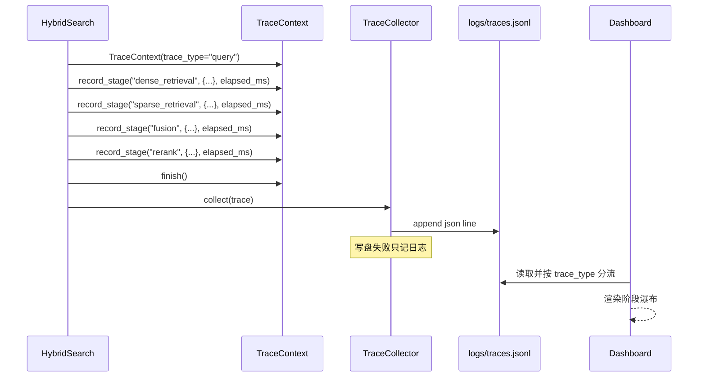

# Feature Specification: Trace and Evaluation

| 字段 | 值 |
|---|---|
| Spec ID | `004-trace-evaluation` |
| Status | implemented |
| Version | 2.0.0 |
| Owner | Observability layer |
| Scope | 摄取与查询双链路 Trace、结构化日志、Dashboard 可视化、自定义与 Ragas 评估、Golden Set 回归 |
| Related | `specs/001-ingestion-pipeline`、`specs/002-hybrid-retrieval`、`specs/003-mcp-interface`、`DEV_SPEC.md` §6.3 §13 |
| Evidence | `src/core/trace/*`、`src/observability/logger.py`、`src/observability/evaluation/*`、`src/observability/dashboard/*`、`src/libs/evaluator/*`、`tests/unit/`、`tests/e2e/test_recall.py`、`tests/e2e/test_dashboard_smoke.py` |

## 1. 背景

RAG 系统的失败几乎从不是「崩溃」，而是「结果悄悄变差」：

| 现象 | 真实原因 | 只看最终回答能发现吗 |
|---|---|---|
| 某个问题突然答不上来 | Sparse 索引没建好，双路退化成单路 | 不能 |
| 回答开始编造 | 重排回退了，相关文档排到第 6 位之后 | 不能 |
| 摄取变慢 | 某个阶段耗时涨了三倍 | 不能 |
| 改了参数「感觉变差了」 | 无法量化，也没法回滚判定 | 不能 |

因此需要两样东西：**能解释一次请求的 Trace**，和**能比较两次改动的评估**。

## 2. 目标

- 摄取与查询两条链路的每个阶段都有可读的阶段记录与耗时。
- Trace 落盘不阻塞、不影响请求结果。
- Trace 可被 Dashboard 按类型分流渲染成瀑布视图。
- 提供不依赖外部服务的自定义指标（`hit_rate`、`mrr`）。
- 提供基于 LLM 的质量指标（`faithfulness`、`answer_relevancy`、`context_precision`）。
- 支持组合多个评估器并容忍部分失败。
- 用版本化的 Golden Set 与 Recall 回归把行为钉住。
- 依赖真实模型的测试必须被显式标记，默认不参与快速验证。

## 3. 非目标

- 不接入统一监控（OpenTelemetry / Prometheus / 告警）。
- 不做分布式链路追踪与跨服务上下文传播。
- 不做 Trace 的长期存储与归档策略。
- 不把 Dashboard 做成生产可观测平台。
- 不保证 Ragas 指标在跨模型版本间完全可比。

## 4. 角色与边界

| 角色 | 可以做 | 不可以做 |
|---|---|---|
| `TraceContext` | 记录阶段、统计耗时、序列化 | 写文件 |
| `TraceCollector` | 追加写 JSON Lines | 解析或聚合 |
| `logger` | 输出结构化日志到 stderr / 文件 | 写 stdout |
| `evaluation/*` | 计算指标、组合评估、跑回归 | 修改检索实现 |
| `dashboard/*` | 只读展示与手动触发 | 持久化业务状态 |
| CI | 跑 `unit` 与 `ruff` | 跑需要真实模型的用例 |

## 5. 功能需求

### 5.1 Trace 上下文

| ID | 优先级 | 需求 | 验证 |
|---|---|---|---|
| R-EVAL-01 | P0 | `TraceContext` 必须包含 `trace_id`（uuid4）、`trace_type ∈ {query, ingestion}`、起止时间、`stages[]`、`metadata`。 | `test_trace_context.py` |
| R-EVAL-02 | P0 | 耗时必须用单调时钟计算，避免系统时间跳变导致异常值。 | `test_trace_context.py` |
| R-EVAL-03 | P0 | `record_stage(name, data, elapsed_ms)` 必须记录阶段名、载荷与耗时。 | `test_trace_context.py` |
| R-EVAL-04 | P0 | `finish()` 必须收敛结束时间；重复调用不得产生非法状态。 | `test_trace_context.py` |
| R-EVAL-05 | P0 | `to_dict()` 必须输出可直接 JSON 序列化的结构。 | `test_trace_context.py` |
| R-EVAL-06 | P1 | 必须提供阶段计时上下文管理器，避免手写计时误差。 | `test_trace_context.py` |

### 5.2 落盘与日志

| ID | 优先级 | 需求 | 验证 |
|---|---|---|---|
| R-EVAL-07 | P0 | `TraceCollector.collect()` 必须把一条 Trace 写成 JSON Lines 一行（UTF-8）。 | `test_trace_service.py` |
| R-EVAL-08 | P0 | 未 `finish()` 的 Trace 在 `collect()` 时必须被自动补 `finish()`，保证落盘数据含耗时。 | `test_trace_service.py` |
| R-EVAL-09 | P0 | 写盘失败只能记录异常日志，**不得**影响请求返回值。 | `test_trace_service.py` |
| R-EVAL-10 | P1 | 目标目录不存在时必须自动创建。 | `test_trace_service.py` |
| R-EVAL-11 | P1 | Trace 文件路径必须由配置驱动（`observability.trace_file`），且基于仓库根解析。 | `test_config_loading.py` |
| R-EVAL-12 | P1 | 结构化日志必须支持 JSON Lines 输出。 | `test_jsonl_logger.py` |

### 5.3 阶段命名

| ID | 优先级 | 需求 | 验证 |
|---|---|---|---|
| R-EVAL-13 | P0 | 摄取链路阶段名固定为 `integrity_check`、`load`、`chunk`、`refine`、`enrich`、`caption`、`dense_encode`、`sparse_encode`、`upsert`、`history`。 | `test_ingestion_trace.py` |
| R-EVAL-14 | P0 | 查询链路阶段名固定为 `query_processing`、`dense_retrieval`、`sparse_retrieval`、`fusion`、`rerank`、`response_build`。 | `test_query_trace.py` |
| R-EVAL-15 | P1 | 阶段记录必须包含方法/Provider 与关键计数，而不只是耗时。 | Trace 检查 |

### 5.4 Dashboard

| ID | 优先级 | 需求 | 验证 |
|---|---|---|---|
| R-EVAL-16 | P0 | Dashboard 必须提供六个页面：总览、数据浏览、摄取管理、摄取追踪、查询追踪、评估面板。 | `test_dashboard_config.py` |
| R-EVAL-17 | P0 | 摄取追踪与查询追踪必须按 `trace_type` 分流，并渲染阶段瀑布。 | `test_trace_service.py` |
| R-EVAL-18 | P0 | Dashboard 必须只读业务数据，唯一允许的写操作是通过 `DocumentManager` 删除文档。 | 代码审查 |
| R-EVAL-19 | P1 | 评估面板必须能展示 Golden Set 与最近一次评估结果。 | `test_evaluation_panel.py` |
| R-EVAL-20 | P1 | Dashboard 冒烟测试必须能在无真实模型的情况下通过。 | `test_dashboard_smoke.py` |

### 5.5 评估器

| ID | 优先级 | 需求 | 验证 |
|---|---|---|---|
| R-EVAL-21 | P0 | `CustomEvaluator` 必须支持 `hit_rate` 与 `mrr`，且不依赖任何外部服务。 | `test_custom_evaluator.py` |
| R-EVAL-22 | P0 | `RagasEvaluator` 必须支持 `faithfulness`、`answer_relevancy`、`context_precision`。 | `test_ragas_evaluator.py` |
| R-EVAL-23 | P0 | `RagasEvaluator` 在 ragas 未安装时必须抛出带安装指引的 `ImportError`。 | `test_ragas_evaluator.py` |
| R-EVAL-24 | P0 | `CompositeEvaluator` 必须依次执行子评估器并合并指标字典。 | `test_composite_evaluator.py` |
| R-EVAL-25 | P0 | 同一指标键冲突时后者覆盖前者，并输出警告（避免静默冲突）。 | `test_composite_evaluator.py` |
| R-EVAL-26 | P0 | 单个子评估器失败必须只记录日志，其余继续执行。 | `test_composite_evaluator.py` |
| R-EVAL-27 | P1 | 评估器必须通过 Factory 按 `evaluation.provider` 获取。 | `test_evaluation_panel.py` |

### 5.6 Golden Set 与回归

| ID | 优先级 | 需求 | 验证 |
|---|---|---|---|
| R-EVAL-28 | P0 | Golden Set 必须是仓库内版本化文件（`tests/fixtures/golden_test_set.json`），含 `version` 与 `test_cases[]`。 | `test_eval_runner.py` |
| R-EVAL-29 | P0 | 每条用例支持 `query`、`expected_chunk_ids`、`expected_sources`、`reference_answer`。 | `test_eval_runner.py` |
| R-EVAL-30 | P0 | `EvalRunner` 必须逐条执行检索，可选生成答案，并输出含逐条明细的结构化报告。 | `test_eval_runner.py` |
| R-EVAL-31 | P0 | `expected_chunk_ids` 为空时必须能优雅跳过 IR 指标，而不是报错或返回 0 分。 | `test_eval_runner.py` |
| R-EVAL-32 | P0 | 召回回归测试必须存在（`tests/e2e/test_recall.py`）。 | 测试文件检查 |
| R-EVAL-33 | P0 | 所有需要真实模型的测试必须打 `llm` 标记。 | `pytest -m "not llm"` 通过 |
| R-EVAL-34 | P1 | 评估报告必须包含 Golden Set 版本与用例数。 | 报告检查 |

## 6. 契约

```python
@dataclass
class TraceContext:
    trace_type: Literal["query", "ingestion"] = "query"
    trace_id: str = field(default_factory=lambda: str(uuid.uuid4()))
    started_at: str = ...          # ISO-8601 UTC
    finished_at: str | None = None
    stages: list[dict] = []        # {"stage": str, "data": dict, "elapsed_ms": float}
    metadata: dict = {}

    def record_stage(self, stage_name: str, data: dict, elapsed_ms: float | None = None) -> None
    def finish(self) -> None
    def to_dict(self) -> dict

@dataclass
class GoldenTestCase:
    query: str
    expected_chunk_ids: list[str] = []
    expected_sources: list[str] = []
    reference_answer: str | None = None

class CustomEvaluator(BaseEvaluator):
    SUPPORTED = {"hit_rate", "mrr"}

class RagasEvaluator(BaseEvaluator):
    SUPPORTED = {"faithfulness", "answer_relevancy", "context_precision"}

class CompositeEvaluator(BaseEvaluator):
    def __init__(self, evaluators: Sequence[BaseEvaluator])

class EvalRunner:
    def run(self, test_set_path, collection=None, top_k=None, generate_answers=False) -> EvalReport
```

## 7. 数据契约

```text
logs/traces.jsonl   一行为一次 Trace：
  { "trace_id", "trace_type", "started_at", "finished_at",
    "stages": [ { "stage", "data", "elapsed_ms" } ], "metadata" }

tests/fixtures/golden_test_set.json
  { "description", "version", "test_cases": [ { "query", "expected_chunk_ids",
    "expected_sources", "reference_answer" } ] }
```

## 8. 时序



## 9. 失败行为

| 场景 | 行为 |
|---|---|
| Trace 未 `finish()` 就被 `collect()` | 自动补 `finish()`，保证 `finished_at` 与耗时存在 |
| Trace 目录不存在 | 自动创建 |
| Trace 写盘失败（权限/磁盘） | `logger.exception` 记录；请求结果不受影响 |
| Trace 字段缺失 | Dashboard 按缺失渲染，不抛异常 |
| ragas 未安装 | `ImportError` 并提示 `pip install ragas datasets` |
| Ragas 调用失败 | 记录日志并返回该用例的失败信息，不中断整个评估 |
| 单个子评估器抛错 | `CompositeEvaluator` 记录并继续其余子评估器 |
| 指标键冲突 | 后者覆盖并输出警告 |
| Golden Set 缺 `expected_chunk_ids` | 跳过 IR 指标，只跑 LLM-as-Judge 类指标 |
| Golden Set 文件缺失或 JSON 非法 | `EvalRunner` 报明确错误，CI 不通过 |
| 评估需要真实模型但未配置 | 按 `llm` 标记被默认排除；显式运行时给出 Provider 错误 |
| Dashboard 读不到索引文件 | 页面展示空状态，不崩溃 |

## 10. 可观测性

- 一条 Trace 就是一次完整的执行解释：阶段顺序、每阶段耗时、Provider、回退状态。
- 阶段名稳定，使 Dashboard 与离线分析脚本可以依赖它。
- 结构化日志（JSON Lines）与 Trace 分离：日志用于运行期排查，Trace 用于结构化的执行解释。
- 评估报告含逐条明细，能定位是「哪个 query 变差了」而不是只知道「平均分下降了」。

## 11. 验收标准

| AC | 内容 | 方式 |
|---|---|---|
| AC1 | Trace 含 uuid、类型、阶段与耗时，且可 JSON 序列化 | `pytest tests/unit/test_trace_context.py -v` |
| AC2 | 未 finish 的 Trace 落盘后仍带结束时间 | `pytest tests/unit/test_trace_service.py -v` |
| AC3 | 写盘失败不影响返回值 | `pytest tests/unit/test_trace_service.py -v` |
| AC4 | 摄取与查询链路阶段名齐全 | `pytest tests/integration/test_ingestion_trace.py tests/integration/test_query_trace.py -v` |
| AC5 | 自定义指标可离线计算 | `pytest tests/unit/test_custom_evaluator.py -v` |
| AC6 | 组合评估器容忍部分失败、指标冲突有警告 | `pytest tests/unit/test_composite_evaluator.py -v` |
| AC7 | Golden Set 缺 `expected_chunk_ids` 时优雅跳过 | `pytest tests/unit/test_eval_runner.py -v` |
| AC8 | 默认快速验证不依赖真实模型 | `pytest -m "not llm"` |
| AC9 | 召回回归可执行 | `pytest tests/e2e/test_recall.py -v` |
| AC10 | 评估可通过 CLI 复现 | `python scripts/evaluate.py --json` |
| AC11 | Dashboard 冒烟通过 | `pytest tests/e2e/test_dashboard_smoke.py -v` |

## 12. 需求追踪

| 需求 | 计划 | 任务 | 验证 |
|---|---|---|---|
| R-EVAL-01 | Plan §3 | T-EVAL-01 | `test_trace_context.py` |
| R-EVAL-02 | Plan §3 | T-EVAL-02 | `test_trace_context.py` |
| R-EVAL-03 | Plan §3 | T-EVAL-03 | `test_trace_context.py` |
| R-EVAL-04 | Plan §3 | T-EVAL-04 | `test_trace_context.py` |
| R-EVAL-05 | Plan §3 | T-EVAL-05 | `test_trace_context.py` |
| R-EVAL-07 | Plan §4 | T-EVAL-06 | `test_trace_service.py` |
| R-EVAL-08 | Plan §4 | T-EVAL-07 | `test_trace_service.py` |
| R-EVAL-09 | Plan §4 | T-EVAL-08 | `test_trace_service.py` |
| R-EVAL-11 | Plan §4 | T-EVAL-09 | `test_config_loading.py` |
| R-EVAL-12 | Plan §4 | T-EVAL-10 | `test_jsonl_logger.py` |
| R-EVAL-13 | Plan §5 | T-EVAL-11 | `test_ingestion_trace.py` |
| R-EVAL-14 | Plan §5 | T-EVAL-12 | `test_query_trace.py` |
| R-EVAL-16 | Plan §6 | T-EVAL-13 | `test_dashboard_config.py` |
| R-EVAL-17 | Plan §6 | T-EVAL-14 | `test_trace_service.py` |
| R-EVAL-18 | Plan §6 | T-EVAL-15 | 代码审查 |
| R-EVAL-19 | Plan §6 | T-EVAL-16 | `test_evaluation_panel.py` |
| R-EVAL-20 | Plan §6 | T-EVAL-17 | `test_dashboard_smoke.py` |
| R-EVAL-21 | Plan §7 | T-EVAL-18 | `test_custom_evaluator.py` |
| R-EVAL-22 | Plan §7 | T-EVAL-19 | `test_ragas_evaluator.py` |
| R-EVAL-23 | Plan §7 | T-EVAL-20 | `test_ragas_evaluator.py` |
| R-EVAL-24 | Plan §7 | T-EVAL-21 | `test_composite_evaluator.py` |
| R-EVAL-25 | Plan §7 | T-EVAL-22 | `test_composite_evaluator.py` |
| R-EVAL-26 | Plan §7 | T-EVAL-23 | `test_composite_evaluator.py` |
| R-EVAL-28 | Plan §8 | T-EVAL-24 | `test_eval_runner.py` |
| R-EVAL-30 | Plan §8 | T-EVAL-25 | `test_eval_runner.py` |
| R-EVAL-31 | Plan §8 | T-EVAL-26 | `test_eval_runner.py` |
| R-EVAL-32 | Plan §8 | T-EVAL-27 | 测试文件检查 |
| R-EVAL-33 | Plan §8 | T-EVAL-28 | `pytest -m "not llm"` |
