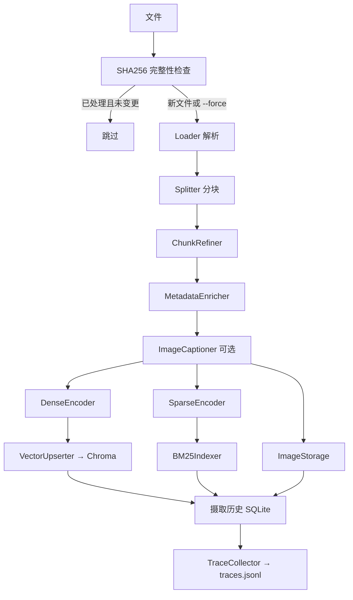
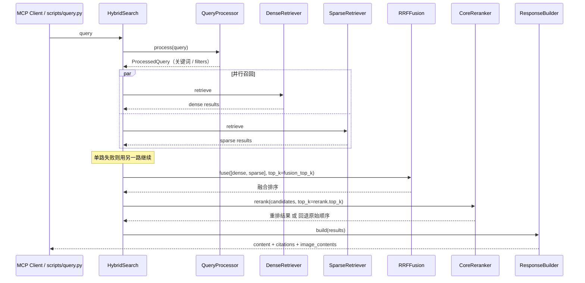

# Developer Specification (DEV_SPEC)

> 本文档是 Modular RAG MCP Server 的项目级设计规格，覆盖系统目标、设计原则、技术选型、模块边界、数据流、存储契约、检索与融合策略、MCP 服务设计、可插拔架构、多模态处理、可观测性与评估、测试方案和演进路线。
>
> - 功能级行为契约见 `specs/<capability>/spec.md`；
> - 实现路径与风险见同目录的 `plan.md`；
> - 工作拆分与需求追溯见同目录的 `tasks.md`；
> - 面向使用者的上手说明见 `README.md`，架构速览见 `docs/architecture/`。
>
> 文档只写**能从仓库复现**的事实。涉及指标的地方都带语料规模、样本量、Provider 与运行口径；做不到复现的描述不写进来。

## 目录

1. 项目概述
2. 设计理念
3. 核心能力
4. 技术选型
5. 系统架构与模块设计
6. 数据流与关键链路
7. 数据契约与存储设计
8. 摄取链路设计
9. 检索、融合与重排设计
10. MCP 服务设计
11. 可插拔架构设计
12. 多模态图片处理设计
13. 可观测性与评估体系
14. 测试方案
15. 配置设计
16. 工程规范
17. 交付里程碑
18. 已知边界
19. 演进路线
20. 术语表

---

## 1. 项目概述

### 1.1 定位

Modular RAG MCP Server 是一个把「资料摄取 → 混合检索 → 结果组装 → 可观测 → 可评估」完整串起来的 RAG 服务，并通过 **MCP（Model Context Protocol）** 把知识检索能力暴露给任意支持该协议的 AI 客户端。

它解决的不是「把向量库接上大模型」这一个点，而是三件事：

1. **检索质量可以被证明**：Dense + Sparse 双路召回、RRF 融合、可插拔重排，并且有 Golden Set 与 Recall 回归把行为钉住。
2. **链路可以被观察**：摄取与查询两条链路的每个阶段都有阶段级 Trace，落成 JSON Lines，可以被 Dashboard 读出来。
3. **组件可以被替换**：LLM、Embedding、Splitter、Reranker、VectorStore、Evaluator 全部走 Factory，换供应商是改配置而不是改代码。

系统的核心边界：它**不生成最终答案**，它返回检索结果、引用与结构化元数据，由调用它的 AI 客户端决定怎么用。

### 1.2 要解决的问题

| 问题 | 常见做法 | 本系统的做法 |
|---|---|---|
| 纯向量检索对专有名词不敏感 | 只用 embedding 召回 | Dense + BM25 Sparse 双路召回，RRF 融合 |
| 两路分数尺度不同，无法直接加权 | 归一化后加权求和 | 使用 RRF：只用名次，不需要分数归一化 |
| 换了模型供应商要改一堆代码 | 直接实例化 SDK 客户端 | 全部走 Factory，配置驱动 |
| RAG 出问题无法定位 | 只看最终回答对不对 | 阶段级 Trace + Dashboard 瀑布视图 |
| 检索质量靠感觉 | 人工抽几个 case 看 | Golden Set + 自定义 IR 指标 + Ragas 指标 |
| 大模型不可用导致摄取全挂 | 直接抛错中断 | Transform 与 Caption 阶段降级为规则路径，不阻塞摄取 |
| 重复摄取产生重复数据 | 全量重跑 | SHA256 完整性检查 + 确定性 chunk id + 幂等 upsert |
| MCP 协议流被日志污染 | print 到处飞 | stdout 只输出 JSON-RPC，日志全部重定向到 stderr |

### 1.3 成功标准

- 同一份文档重复摄取不会产生重复记录，内容变更会产生新的 chunk id。
- 单路召回失败时另一路仍能返回结果（graceful degradation）。
- 重排后端不可用时能回退到融合顺序，并在结果里标明使用了回退。
- 每一次查询都能在 Trace 里还原出各阶段耗时与 Provider。
- Golden Set 与 Recall 回归可以在本地一条命令跑完，且默认不需要真实模型 Key。
- 新增一个 Provider 只需要实现接口 + 注册 Factory 分支。

### 1.4 非目标

- 不生成最终自然语言答案（这是客户端 LLM 的职责）。
- 不提供生产级集群、分布式事务、多租户与配额治理。
- 不实现多实例并发写入同一份索引。
- 不实现 OCR、表格结构还原与视频理解。
- 不把 Dashboard 描述为生产可观测平台。
- 不承诺对超大语料的性能表现。

---

## 2. 设计理念

### 2.1 协议优先：MCP 的输入输出是唯一对外契约

对外只有一个协议面。工具名、入参 Schema、返回值结构一旦发布就视为稳定契约；内部实现可以重构，工具契约不能随意漂移。

因此：

- 工具的 `input_schema` 是显式声明的 JSON Schema，不靠函数签名推断；
- 返回值统一是 MCP `Content` 数组（`TextContent` / `ImageContent`），机器可消费的结构化字段放在 `structuredContent`；
- 错误用 JSON-RPC 标准错误码表达，而不是把异常文本塞进正常结果里。

### 2.2 本地优先：默认零外部依赖也能跑通链路

默认配置使用 Chroma（嵌入式向量库）、SQLite（摄取历史）、JSONL（Trace）、本地目录（图片文件），不需要任何外部服务就能把完整链路跑起来。这让「clone 下来能不能跑」这件事不依赖云账号。

代价写在明处：本地存储不是生产集群，见 §18。

### 2.3 全链路可插拔：替换是配置变更，不是代码重写

六个可替换维度：LLM、Embedding、Vision LLM、Splitter、VectorStore、Reranker、Evaluator。每个维度都由「抽象基类 + 具体实现 + 工厂」三段组成。

约束：

- 抽象基类定义契约，不允许具体实现私自扩展必需参数；
- 工厂是唯一的实例化入口，业务代码不 `import` 具体实现；
- 新实现必须能在没有真实外部服务的情况下被单元测试（通过 Mock 或本地后端）。

### 2.4 白盒可观测：每个阶段都要留下可解释的数据

RAG 的失败通常不是「崩了」，而是「结果悄悄变差」。因此摄取和查询两条链路的每一个阶段都要记录：

```text
stage_name / provider / method / elapsed_ms / 关键输入输出摘要 / 错误
```

Trace 落成 JSON Lines，一条记录就是一次完整请求；Dashboard 把它们读成瀑布视图。没有 Trace 的阶段视为未完成实现。

### 2.5 失败局部降级，不阻断主链路

| 组件 | 失败时的行为 |
|---|---|
| Chunk Refiner（LLM） | 回退到规则去噪 |
| Metadata Enricher（LLM） | 回退到规则增强 |
| Image Captioner | 跳过该图片，不阻塞其余 chunk |
| Reranker | 回退到 RRF 融合顺序，并标记 `used_fallback` |
| 单路召回（Dense 或 Sparse） | 用另一路结果继续 |
| Trace 落盘 | 记录异常日志，不影响请求返回 |

原则：**可选增强组件的失败不允许变成整个请求的失败**；必需组件（加载、分块、向量化、写入）的失败必须显式暴露。

### 2.6 质量必须可回归

- Golden Set 是版本化的仓库文件，不是一次性的 Notebook 结果。
- 评估同时包含「检索指标」（hit_rate、MRR）与「生成质量指标」（faithfulness、answer_relevancy、context_precision）。
- 依赖真实模型的测试打 `llm` 标记，默认不参与快速验证，保证离线可测。
- 指标报出时必须说明语料、样本量与 Provider，否则数字没有解释力。

### 2.7 确定性优先

同样的输入应该产生同样的输出与同样的标识：

- chunk id 由内容哈希决定，不由自增序列决定；
- RRF 融合在分数相同时用 `chunk_id` 做稳定的 tie-break；
- 文件是否已摄取由 SHA256 决定；
- 测试数据固定随机种子。

---

## 3. 核心能力

### 3.1 文档摄取

支持 PDF 与 Markdown 等文本来源，链路为：

```text
文件完整性校验（SHA256）→ 加载 → 语义分块 → Chunk 精炼 → 元数据增强
  → 图片 Caption（可选）→ Dense 编码 → Sparse 编码 → 索引写入 → 摄取历史记录
```

关键性质：

- **幂等**：同一文件重复摄取会被 SHA256 跳过（除非显式 `--force`）。
- **确定性标识**：`doc_id` 为文件 SHA256；chunk id 由「doc 前缀 + 零填充序号 + 内容哈希前缀」组成。
- **可降级**：所有 LLM 增强都可关闭或失败回退，不影响 chunk 落库。
- **可观测**：每个阶段写入 Trace，包含阶段名、耗时与 Provider。

### 3.2 混合检索

```text
Query → QueryProcessor（关键词抽取 / filters）
        ├── DenseRetriever   → 向量近邻 Top-K
        └── SparseRetriever  → BM25 Top-K
        → RRFFusion → fusion_top_k
        → Reranker → rerank.top_k
        → ResponseBuilder → 引用 + 多模态内容
```

- 双路可并行执行；单路失败不阻断。
- 融合用 RRF（只用名次，不需要分数归一化）。
- 重排可关闭（`rerank.provider: none`）。
- 默认参数：`dense_top_k: 20`、`sparse_top_k: 20`、`fusion_top_k: 10`、`rrf_k: 60`、`rerank.top_k: 5`。

### 3.3 MCP 知识检索服务

通过官方 MCP SDK 与 stdio transport 暴露三个工具：

| 工具 | 作用 | 必需参数 |
|---|---|---|
| `query_knowledge_hub` | 混合检索并返回带引用的结果 | `query` |
| `list_collections` | 列出可用集合与（可选）统计信息 | — |
| `get_document_summary` | 按 `doc_id` 返回标题、摘要、标签、来源与 chunk 数 | `doc_id` |

协议约束：stdout 只能出现 JSON-RPC 消息，任何日志都必须走 stderr。重依赖（如 chromadb）必须在主线程预加载，避免与 SDK 的 I/O 线程争抢导入锁。

### 3.4 可观测性与可视化管理

- 摄取链路 Trace + 查询链路 Trace，落 `logs/traces.jsonl`。
- Streamlit Dashboard 六个页面：总览、数据浏览、摄取管理、摄取追踪、查询追踪、评估面板。
- 每个页面只读数据源（向量库 / BM25 索引 / SQLite / JSONL），不持有独立状态。

### 3.5 评估体系

- 自定义轻量指标：`hit_rate`、`mrr`。
- Ragas 指标：`faithfulness`、`answer_relevancy`、`context_precision`。
- `CompositeEvaluator` 组合多个评估器并合并指标，单个评估器失败不影响其余。
- `EvalRunner` 读取 Golden Set，逐条跑检索（可选生成答案），输出结构化报告。
- `tests/e2e/test_recall.py` 做召回回归。

### 3.6 多模态处理

- 摄取阶段：图片从文档中抽取、落盘、建映射表，可选生成 Caption 并把 Caption 文本并入可检索内容。
- 查询阶段：命中含图片的 chunk 时，`MultimodalAssembler` 读出图片文件、按魔数或扩展名判定 MIME、base64 编码成 MCP `ImageContent` 一并返回。
- 图片缺失或读取失败只影响该图片，不影响文本结果。

---

## 4. 技术选型

| 领域 | 选择 | 放弃方案 | 理由 |
|---|---|---|---|
| 语言 | Python 3.10+ | Go / Node | RAG 与 LLM 生态（Ragas、LangChain Splitter、mcp SDK）集中在 Python |
| 配置 | YAML + dataclass 校验 | 纯环境变量 / Pydantic Settings | 需要表达嵌套结构（provider + model + 参数），且要给出明确的 `SettingsError` |
| 向量库 | Chroma（默认） | Pinecone / Milvus | 嵌入式、零外部服务，clone 即可跑；接口层允许替换 |
| 稀疏检索 | BM25（jieba 分词） | 纯向量 | 专有名词、代码标识符、缩写是向量弱项 |
| 融合 | RRF | 加权求和 | 两路分数尺度不可比，RRF 无需归一化且对异常分数鲁棒 |
| 重排 | 可插拔（none / cross_encoder / llm） | 强制重排 | 重排成本高且依赖模型可用性，必须能关、能降级 |
| 分块 | 可插拔 Splitter（recursive / semantic / fixed_length） | 单一固定切分 | 文档结构差异大，需要按场景选策略 |
| 摄取历史 | SQLite（WAL） | 服务端数据库 | 单机场景下零运维，且支持并发读写 |
| 追踪 | JSON Lines | 数据库表 | 追加写、易读、易被 Dashboard 增量消费 |
| 评估 | Ragas + 自定义 | 只看人工体感 | 需要可比较的数字与可版本化的回归集 |
| 可视化 | Streamlit | 前端自研 | 调试工具的投入产出比优先 |
| 协议 | MCP 官方 SDK（stdio） | 自研 JSON-RPC | 协议演进由官方维护，避免自己实现协商与错误码 |
| 测试 | pytest + marker 分层 | 只跑端到端 | 需要离线快速验证与显式标记的联网验证两条路径 |

---

## 5. 系统架构与模块设计

### 5.1 分层结构

```text
┌──────────────────────────────────────────────────────────┐
│ 接入层  MCP Client（Claude Desktop / Copilot / 自研）      │
│         Streamlit Dashboard（调试与可视化）                │
└───────────────┬──────────────────────────────────────────┘
                ▼
┌──────────────────────────────────────────────────────────┐
│ 接口层  src/mcp_server/    server / protocol_handler / tools
│         scripts/           ingest / query / evaluate / dashboard
└───────────────┬──────────────────────────────────────────┘
                ▼
┌──────────────────────────────────────────────────────────┐
│ 核心层  src/core/query_engine/   Processor / Dense / Sparse /
│                                  Fusion / Reranker / HybridSearch
│         src/core/response/       ResponseBuilder / Citation /
│                                  MultimodalAssembler
│         src/core/trace/          TraceContext / TraceCollector
│         src/core/types.py        共享数据类型
└───────────────┬──────────────────────────────────────────┘
                ▼
┌──────────────────────────────────────────────────────────┐
│ 摄取层  src/ingestion/  chunking / transform / embedding / storage
│         pipeline / document_manager
└───────────────┬──────────────────────────────────────────┘
                ▼
┌──────────────────────────────────────────────────────────┐
│ 能力层  src/libs/  llm / embedding / splitter / reranker /
│                    vector_store / loader / evaluator
└───────────────┬──────────────────────────────────────────┘
                ▼
┌──────────────────────────────────────────────────────────┐
│ 存储层  Chroma（向量）· BM25 索引 · SQLite（摄取历史 / 图片映射）
│         logs/traces.jsonl（Trace）· data/（上传与图片文件）
└──────────────────────────────────────────────────────────┘
```

依赖方向自上而下单向：接入层不直接访问存储层；能力层不感知检索流程；`src/libs/` 不导入 `src/core/query_engine/`。

### 5.2 目录结构

```text
src/
├── core/
│   ├── settings.py                配置加载、校验与路径解析
│   ├── types.py                   Document / Chunk / RetrievalResult / ProcessedQuery
│   ├── query_engine/
│   │   ├── query_processor.py     查询预处理与关键词抽取
│   │   ├── dense_retriever.py     向量检索
│   │   ├── sparse_retriever.py    BM25 检索
│   │   ├── fusion.py              RRF 融合
│   │   ├── reranker.py            重排编排与 fallback
│   │   └── hybrid_search.py       双路编排
│   ├── response/
│   │   ├── response_builder.py    MCP 响应组装
│   │   ├── citation_generator.py  引用结构
│   │   └── multimodal_assembler.py 图文内容组装
│   └── trace/
│       ├── trace_context.py       阶段级追踪上下文
│       └── trace_collector.py     JSON Lines 持久化
├── ingestion/
│   ├── pipeline.py                摄取编排
│   ├── document_manager.py        文档增删查
│   ├── chunking/document_chunker.py
│   ├── transform/                 chunk_refiner / metadata_enricher / image_captioner
│   ├── embedding/                 dense_encoder / sparse_encoder / batch_processor
│   └── storage/                   vector_upserter / bm25_indexer / image_storage
├── mcp_server/
│   ├── server.py                  SDK 入口与 stdio 约束
│   ├── protocol_handler.py        工具注册、Schema、JSON-RPC 错误码
│   └── tools/                     query_knowledge_hub / list_collections / get_document_summary
├── observability/
│   ├── logger.py                  结构化日志（stderr / JSON）
│   ├── evaluation/                ragas / custom / composite / eval_runner
│   └── dashboard/                 六个页面 + 三个服务
└── libs/
    ├── llm/                       base / openai / azure / ollama / deepseek / vision / factory
    ├── embedding/                 base / openai / azure / ollama / factory
    ├── splitter/                  base / recursive / semantic / fixed / factory
    ├── vector_store/              base / chroma / qdrant / pinecone / factory
    ├── reranker/                  base（含 NoneReranker）/ cross_encoder / llm / factory
    ├── loader/                    base / pdf / file_integrity
    └── evaluator/                 base / custom / factory
config/
├── settings.yaml                  主配置
├── test_credentials.yaml.example  凭据模板
└── prompts/                       chunk_refinement / image_captioning /
                                   metadata_enrichment / rerank
scripts/                           ingest / query / evaluate / start_dashboard
tests/                             unit / integration / e2e / fixtures
specs/                             本规格与功能级契约
docs/                              ai-engineering / testing / architecture
```

### 5.3 模块职责

| 模块 | 负责 | 不负责 |
|---|---|---|
| `core/settings.py` | 读取 YAML、校验必填字段、解析仓库相对路径 | 业务逻辑、Provider 实例化 |
| `core/types.py` | 共享数据结构契约 | IO |
| `core/query_engine/*` | 查询预处理、双路召回、融合、重排 | 文档写入 |
| `core/response/*` | 引用生成、文本/图片内容组装 | 检索排序 |
| `core/trace/*` | 阶段记录、耗时统计、JSONL 落盘 | 日志级别与格式（由 logger 负责） |
| `ingestion/*` | 加载、分块、增强、编码、索引写入 | 对外协议 |
| `mcp_server/*` | 工具注册、Schema、协议错误处理 | 检索算法 |
| `observability/evaluation/*` | 指标计算、组合评估、回归执行 | 检索实现 |
| `observability/dashboard/*` | 只读展示与手动触发 | 状态持久化 |
| `libs/*` | 可替换能力实现 | 编排决策 |

### 5.4 关键设计：stdout 纯净与导入死锁

MCP 的 stdio transport 用 stdout 传 JSON-RPC。任何第三方库往 stdout 打一行日志都会破坏协议流。因此 `server.py` 在启动时把所有 root logger 的 stream handler 重定向到 stderr。

更隐蔽的问题是导入死锁：SDK 基于 anyio 使用后台线程做 stdin/stdout I/O，而工具处理函数在 worker 线程里执行；如果 worker 线程此时首次 `import chromadb`（会连带加载 onnxruntime、numpy、sqlite3 C 扩展），它会与正在读 stdin 的线程争抢 Python 的全局导入锁，产生卡死。因此在 anyio 拉起 I/O 线程**之前**，在主线程预加载重依赖，之后 worker 线程的 `import` 只命中 `sys.modules` 直接返回。

---

## 6. 数据流与关键链路

### 6.1 摄取链路



各阶段的可降级点：

- `ChunkRefiner`：`chunk_refiner.use_llm=false` 或调用失败 → 规则去噪。
- `MetadataEnricher`：`metadata_enricher.use_llm=false` 或调用失败 → 规则增强。
- `ImageCaptioner`：`vision_llm.enabled=false` 或调用失败 → 不生成 caption。
- 任一阶段异常：写入 Trace 的错误字段，按阶段语义决定中断或继续。

### 6.2 查询链路



### 6.3 Trace 链路

```text
TraceContext（query / ingestion）
  ├ record_stage("dense_retrieval", {provider, method, top_k}, elapsed_ms)
  ├ record_stage("sparse_retrieval", ...)
  ├ record_stage("fusion", {k, input_counts, output_count}, elapsed_ms)
  ├ record_stage("rerank", {reranker_type, used_fallback, fallback_reason}, elapsed_ms)
  └ finish() → TraceCollector.collect() → logs/traces.jsonl
```

`TraceContext` 内部维护单调时钟计算真实耗时，`to_dict()` 输出可序列化结构供 Dashboard 消费。未 `finish()` 的 Trace 在 `collect()` 时会被自动补上结束时间，保证落盘记录总有耗时数据。

---

## 7. 数据契约与存储设计

### 7.1 核心数据类型

```python
Document      # 一次加载的结果：文本内容 + 来源路径 + 元数据
Chunk         # 分块结果：临时 id + 文本 + 元数据(source_path, chunk_index, ...)
ChunkRecord   # 写库记录：确定性 chunk_id + 向量 + 元数据
ProcessedQuery# 查询预处理结果：原始 query + 关键词 + filters
RetrievalResult
    chunk_id: str
    score: float
    text: str | None
    metadata: dict
```

`RetrievalResult` 是整个检索层唯一的中间表示：Dense、Sparse、Fusion、Rerank、ResponseBuilder 都只在这一个类型上工作，因此每一层都可以单独测试与替换。

### 7.2 确定性标识

```text
doc_id   = SHA256(文件二进制)                       # 64 位十六进制
chunk_id = f"{doc_id[:8]}_{chunk_index:04d}_{sha256(chunk.text)[:8]}"
```

例如 `a1b2c3d4_0000_e5f6g7h8`。这个方案满足三个性质：

| 性质 | 原因 |
|---|---|
| 幂等 | 同样内容 → 同样 id → 重复写入覆盖同一行 |
| 可版本化 | 内容改变 → 哈希改变 → 新 id，旧记录可对比 |
| 可追溯 | 前缀对应来源文档，中段对应在原文档中的位置 |

不使用自增 ID 的原因：增量摄取与重跑无法保证顺序一致，自增 ID 会让同一份内容在不同运行中得到不同标识。

### 7.3 存储介质

| 介质 | 内容 | 说明 |
|---|---|---|
| Chroma | chunk 向量 + 文本 + 元数据 | 默认后端，`persist_directory: ./data/db/chroma` |
| BM25 索引 | 倒排索引（jieba 分词） | 与向量库共用同一批 `chunk_id`，Sparse 命中后用 `get_by_ids` 取回文本 |
| SQLite | 摄取历史、文件 SHA256、图片映射 | WAL 模式支持并发读写 |
| JSON Lines | Trace | 追加写，Dashboard 增量消费 |
| 本地目录 | 上传文件与抽取的图片 | 路径由 `resolve_path` 基于仓库根解析，与 CWD 无关 |

三个存储共享同一套 `chunk_id`，这是双路召回能融合的前提：RRF 只能融合「同一个 id 出现在两个排名列表里」的结果。

### 7.4 幂等写入

```python
upsert(chunks, vectors):
    for chunk, vector in zip(chunks, vectors):
        record = ChunkRecord(id=deterministic_id(chunk), vector=vector, metadata=...)
        vector_store.upsert(record)   # 同 id 覆盖
```

批处理保持输入顺序，同一批次内产生的写入顺序稳定，便于失败后定位到具体 chunk。

---

## 8. 摄取链路设计

### 8.1 阶段划分与产物

| 阶段 | 输入 | 输出 | 可降级 |
|---|---|---|---|
| 完整性检查 | 文件路径 | SHA256 / 是否跳过 | 否 |
| 加载 | 文件 | `Document` | 否 |
| 分块 | `Document` | `Chunk[]` | 否 |
| 精炼 | `Chunk[]` | 去噪后的 `Chunk[]` | 是（规则回退） |
| 元数据增强 | `Chunk[]` | 带标签的 `Chunk[]` | 是（规则回退） |
| 图片 Caption | 图片 | caption 文本 | 是（跳过） |
| Dense 编码 | `Chunk[]` | `float[][]` | 否 |
| Sparse 编码 | `Chunk[]` | BM25 统计 | 否 |
| 写入 | chunks + 向量 | 存储记录 | 否 |
| 历史记录 | 结果 | SQLite 行 | 是（不阻塞返回） |

### 8.2 完整性检查

```text
compute_sha256(path) → hash
should_skip(hash)    → 已成功处理过该 hash 则 True
mark_success(hash)   → 摄取成功后记录
mark_failure(hash)   → 失败可重试（失败不阻断重新摄取）
```

SQLite 使用 WAL 模式，支持并发读与写；失败记录保留但不阻止重试，这是刻意的设计：一次网络抖动不应该让用户必须手动清表才能重跑。

### 8.3 分块

分块由 `SplitterFactory` 选择策略：

| 策略 | 说明 |
|---|---|
| `recursive` | 默认，按分隔符层级递归切分，尽量保持语义完整 |
| `semantic` | 基于语义边界切分 |
| `fixed_length` | 固定长度切分 |

配置：`chunk_size: 1000`、`chunk_overlap: 200`、`batch_size: 100`。重叠区间的意义是避免关键句被切在两个 chunk 之间导致检索漏召回；代价是存储与 embedding 调用量上升约 20%。

### 8.4 精炼与元数据增强

`ChunkRefiner` 与 `MetadataEnricher` 都是「LLM 增强 + 规则回退」的双路径结构：

```text
use_llm == true  → 调用 LLM（Prompt 来自 config/prompts/*.txt）
                 → 调用失败或输出不可解析 → 规则路径
use_llm == false → 直接走规则路径
```

默认关闭 LLM 路径，原因是它会让摄取成本与外部依赖陡增；开启后也必须保证规则回退可用，否则一次限流就会让整批摄取失败。

### 8.5 编排与进度

`IngestionPipeline` 负责阶段编排、结果统计与进度回调（`on_progress`）。`PipelineResult` 至少包含：是否成功、文件路径、`doc_id`、chunk 数、各阶段耗时与错误信息。

`DocumentManager` 提供文档级操作（列表、详情、删除）。删除必须同时清理向量记录、BM25 条目与图片映射，否则会出现「检索得到但取不回文本」的悬空引用。

---

## 9. 检索、融合与重排设计

### 9.1 查询预处理

`QueryProcessor` 产出 `ProcessedQuery`：原始查询、用于 Sparse 的关键词列表、可选的过滤条件（集合、来源等）。把「预处理」单独成层的好处是：将来要做 Query Rewrite、同义词扩展、实体识别，都只改这一层，不影响召回实现。

### 9.2 双路召回

| 路径 | 实现 | 强项 | 弱项 |
|---|---|---|---|
| Dense | `VectorStore.query(embedding, top_k)` | 语义相近、表述不同 | 专有名词、编号、代码标识符 |
| Sparse | BM25 倒排 + `get_by_ids` 补文本 | 精确词命中、术语敏感 | 同义改写、跨语言 |

两路默认各取 Top-20。`HybridSearch` 支持并行执行（线程池），并实现 graceful degradation：

```text
两路都成功 → 融合两路
一路失败   → 用成功的那一路继续，记 Trace 警告
两路都失败 → 抛出明确错误
```

### 9.3 RRF 融合

```text
RRF_score(d) = Σ_list 1 / (k + rank_list(d))
```

- `k = 60`（`retrieval.rrf_k`，论文推荐值）。
- **只用名次，不用原始分数**：Dense 的余弦相似度与 BM25 的分数处于完全不同的量级，任何加权求和在两路分数分布变化时都会失稳。
- **确定性**：分数相同时按 `chunk_id` 稳定排序，保证同一输入两次运行顺序一致，否则回归测试会随机失败。
- **缺失容忍**：只在单路出现的文档仍然计分，不会因为另一路没有它而被丢弃——这正是混合检索提升召回的关键。

融合后取 `fusion_top_k`（默认 10）进入重排。

### 9.4 重排

`CoreReranker` 编排 `src/libs/reranker/` 的后端：

| Provider | 说明 |
|---|---|
| `none` | `NoneReranker`，直接返回融合顺序（默认） |
| `cross_encoder` | 交叉编码器重排（默认模型 `cross-encoder/ms-marco-MiniLM-L6-v2`） |
| `llm` | 用 LLM 按 `config/prompts/rerank.txt` 打重要性排序 |

行为契约：

```python
RerankConfig(enabled=True, top_k=5, timeout=30.0, fallback_on_error=True)
RerankResult(results, used_fallback, fallback_reason, reranker_type, original_order)
```

- 后端异常或超时且 `fallback_on_error=True` → 返回原始顺序，`used_fallback=True`，`fallback_reason` 记录原因。
- `original_order` 保留重排前的顺序，便于对比「重排是否真的改善了排序」。
- 重排是**可选增强**：关掉它链路仍然完整可用。

### 9.5 响应组装

`ResponseBuilder` 产出 `MCPToolResponse`：

```python
content: str                  # 人类可读 Markdown，带 [1] [2] 引用标记
citations: list[Citation]     # 结构化引用
metadata: dict                # query / result_count 等
is_empty: bool                # 是否空结果
image_contents: list[ImageContent]
```

`Citation` 包含 `index / chunk_id / source / page / score / text_snippet / metadata`。保留 `chunk_id` 与 `source` 是为了让客户端能把引用指回原文，而不是只给一段无法溯源的文本。

---

## 10. MCP 服务设计

### 10.1 启动与传输

```text
main.py → src/mcp_server/server.py
  1. 重定向所有 root logger 到 stderr（保护 stdout 协议流）
  2. 主线程预加载重依赖（避免 worker 线程导入死锁）
  3. 创建 Server(name="modular-rag-mcp-server", version=...)
  4. 注册 tools/list 与 tools/call 处理
  5. 以 stdio transport 进入事件循环
```

### 10.2 工具注册

`ProtocolHandler` 持有 `tools: dict[str, ToolDefinition]`，每个 `ToolDefinition` 含 `name / description / input_schema / handler`。

| 工具 | input_schema 要点 | 返回 |
|---|---|---|
| `query_knowledge_hub` | `query` (string, required)、`top_k` (integer, default 5, minimum 1)、`collection` (string, optional) | `TextContent`（Markdown + 引用），命中图片时附 `ImageContent` |
| `list_collections` | `include_stats` (boolean, default true) | 集合列表与文档数 |
| `get_document_summary` | `doc_id` (string, required，支持完整 id 或哈希片段)、`collection` (optional) | 标题、摘要、标签、来源路径、chunk 数 |

Schema 显式书写而不从 Python 签名推断，原因是 MCP 客户端直接消费这段 Schema，字段描述与默认值属于对外契约。

### 10.3 错误处理

```text
-32700 PARSE_ERROR       非法 JSON
-32600 INVALID_REQUEST   请求结构不符合 JSON-RPC 2.0
-32601 METHOD_NOT_FOUND  未知工具或未知方法
-32602 INVALID_PARAMS    缺少必需参数、参数类型错误
-32603 INTERNAL_ERROR    工具内部未预期异常
```

失败语义：

- 未知工具 → `-32601`，不执行任何检索。
- 缺少 `query` → `-32602`，不抛 Python 异常。
- 检索无结果 → **不是错误**：正常返回 `is_empty=True` 与空结果说明，让客户端能区分「查不到」和「调用失败」。
- 工具内部异常 → `-32603`，并把详细堆栈写到 stderr 日志而不是返回给客户端。

### 10.4 返回值形态

```text
content: [ { type: "text", text: "<Markdown 结果与引用>" },
           { type: "image", data: "<base64>", mimeType: "image/png" } ]   # 命中图片时
structuredContent: { citations: [...], metadata: {...} }                # 机器可消费
```

文本面向模型阅读，结构化字段面向调用方程序处理，两者同时返回，避免调用方为了拿引用去解析 Markdown。

---

## 11. 可插拔架构设计

### 11.1 三段式结构

每个可替换维度都由三部分组成：

```text
<domain>/
├── base_<domain>.py        抽象基类，定义契约
├── <provider>_<domain>.py  具体实现（可多个）
└── <domain>_factory.py     工厂：按配置选实现
```

| 维度 | 抽象基类 | 已有实现 | 配置键 |
|---|---|---|---|
| LLM | `BaseLLM` | openai / azure / ollama / deepseek | `llm.provider` |
| Vision LLM | `BaseVisionLLM` | openai / azure / ollama | `vision_llm.provider` |
| Embedding | `BaseEmbedding` | openai / azure / ollama | `embedding.provider` |
| Splitter | `BaseSplitter` | recursive / semantic / fixed_length | `ingestion.splitter` |
| VectorStore | `BaseVectorStore` | chroma / qdrant / pinecone | `vector_store.provider` |
| Reranker | `BaseReranker` | none / cross_encoder / llm | `rerank.provider` |
| Evaluator | `BaseEvaluator` | custom / ragas | `evaluation.provider` |

### 11.2 契约约束

1. **工厂是唯一实例化入口**：业务代码只 `from ...factory import XFactory`，不直接 `import` 具体实现类。
2. **抽象基类不预设具体 Provider 的参数**：Provider 特有配置（`azure_endpoint`、`deployment_name`、`base_url`）作为可选字段出现在配置对象上，由具体实现自行校验。
3. **未知 Provider 必须报错而不是静默回退**：配置写错时立刻 `SettingsError`，避免「以为换了模型其实没换」。
4. **`NoneReranker` 是合法实现**：关闭重排不需要在编排层写 `if`。

### 11.3 新增 Provider 的步骤

```text
1. 实现 Base<Domain> 的所有抽象方法
2. 在 <domain>_factory.py 中注册 provider 分支
3. 在 config/settings.yaml 增加对应配置（含 Provider 特有字段）
4. 增加单元测试：工厂能按配置实例化 + 契约方法可被 Mock
5. 涉及外部服务的实现，测试打 integration 标记
```

不改动的部分：编排层、Trace 结构、响应组装、MCP 工具定义。

### 11.4 为什么工厂而不是依赖注入框架

项目规模下，显式工厂比引入 DI 框架更可读：配置文件 → `Settings` 对象 → 工厂 → 实例，四步全在代码里可见，出问题能直接断点。DI 框架带来的收益（自动装配、生命周期管理）在这个规模下小于它的心智成本。

---

## 12. 多模态图片处理设计

### 12.1 摄取侧

```text
文档解析 → 抽取图片 → 落盘到 data/ 下的图片目录 → 写图片映射表（SQLite）
        → 图片与 chunk 建立关联（图片所在 chunk 的元数据带引用）
        → 可选：Vision LLM 生成 Caption → Caption 并入该 chunk 的可检索文本
```

- `vision_llm.enabled: false` 时完全跳过 Caption，不影响文本链路。
- `vision_llm.max_image_size: 2048` 控制送入模型前压缩的最长边，避免超大图带来的成本与超时。
- Caption 生成失败只记录 Trace 错误并跳过该图片，不阻塞其它 chunk 落库。

把 Caption 并入可检索文本是关键决策：图片内容由此进入向量与 BM25 的检索范围，用户用文字描述图片内容时也能命中。

### 12.2 查询侧

`MultimodalAssembler` 的职责：

1. 从命中 chunk 的元数据里识别图片引用；
2. 读取图片文件（懒加载：只有被请求时才读）；
3. 判定 MIME 类型：先按扩展名映射，再用魔数嗅探兜底（扩展名可能被改名或缺失）；
4. base64 编码成 MCP `ImageContent`；
5. 与 `TextContent` 一起组成返回数组。

| 容错 | 行为 |
|---|---|
| 图片文件不存在 | 记录日志，跳过该图片，文本结果照常返回 |
| 扩展名与内容不符 | 用魔数判定（`\x89PNG`、`\xff\xd8\xff`、`GIF8`、`RIFF`、`BM`…） |
| 路径越界或不可读 | 跳过该图片 |
| 全部图片都失败 | 返回纯文本结果，`is_empty` 仍由检索结果决定 |

多模态是**增量能力**：关掉它系统仍然是一个完整的文本 RAG 服务。

---

## 13. 可观测性与评估体系

### 13.1 Trace 结构

```python
TraceContext:
    trace_id: str            # uuid4
    trace_type: "query" | "ingestion"
    started_at / finished_at  # ISO-8601 UTC
    stages: list[dict]       # 有序阶段记录
    metadata: dict           # 请求级附加信息

stage = { "stage": str, "data": {...}, "elapsed_ms": float }
```

耗时用 `time.monotonic()` 计算，避免系统时间跳变导致负值或异常放大。`finish()` 收敛结束时间；`collect()` 对未结束的 Trace 自动补 `finish()`，保证落盘数据完整。

### 13.2 落盘与消费

```text
TraceContext → TraceCollector.collect() → logs/traces.jsonl（追加，UTF-8）
```

一行一次请求，字段自包含。Dashboard 的 `trace_service` 负责读取并按 `trace_type` 分流到「摄取追踪」「查询追踪」两个页面。写盘失败只记录异常日志，**不影响请求返回**——观测性不应该成为可用性的单点。

### 13.3 阶段命名

阶段名是对外可读的诊断接口，需要稳定：

| trace_type | stage |
|---|---|
| `ingestion` | `integrity_check`、`load`、`chunk`、`refine`、`enrich`、`caption`、`dense_encode`、`sparse_encode`、`upsert`、`history` |
| `query` | `query_processing`、`dense_retrieval`、`sparse_retrieval`、`fusion`、`rerank`、`response_build` |

### 13.4 评估体系

| 评估器 | 指标 | 依赖 |
|---|---|---|
| `CustomEvaluator` | `hit_rate`、`mrr` | 无（纯计算） |
| `RagasEvaluator` | `faithfulness`、`answer_relevancy`、`context_precision` | ragas + LLM |
| `CompositeEvaluator` | 合并上述指标 | 被组合的评估器 |

组合语义：

- 每个子评估器用同样入参依次执行；
- 指标字典合并；
- 同名指标后者覆盖前者并打警告（避免静默的语义冲突）；
- **单个子评估器失败只记录日志，其余照常执行**。

`EvalRunner` 的执行流程：

```text
读取 Golden Set（JSON）
  → 逐条执行 HybridSearch
  → 可选生成答案（需要 LLM）
  → 调用配置的 Evaluator
  → 汇总为 EvalReport（含逐条详情与整体指标）
```

`GoldenTestCase` 字段：`query`、`expected_chunk_ids`、`expected_sources`、`reference_answer`。其中 `expected_chunk_ids` 为空时只能跑 LLM-as-Judge 类指标，无法计算 hit_rate / MRR——这是当前 Golden Set 的已知局限，见 §18。

### 13.5 评估纪律

- 依赖真实模型的测试打 `llm` 标记，默认不参与快速验证。
- Golden Set 与阈值作为版本化输入维护，不允许用一次性 Notebook 结果替代。
- 报告里必须写明语料、样本量、Provider 与运行命令。

---

## 14. 测试方案

### 14.1 分层策略

| 层 | marker | 范围 | 是否联网 |
|---|---|---|---|
| Unit | `unit` | 契约、工厂、解析、纯算法、Mock 交互 | 否 |
| Integration | `integration` | 组件边界与存储适配（Chroma 往返、Pipeline、MCP Server、Trace 打点） | 部分需要 |
| E2E | `e2e` | 完整摄取与查询链路（数据摄取、MCP 客户端、召回回归、Dashboard 冒烟） | 是 |
| LLM | `llm` | 需要真实模型 Key 的验证 | 是 |
| Slow | `slow` | 不宜每次本地编辑都跑的用例 | — |

```bash
pytest -m unit
pytest -m "not llm"
pytest --cov=src
ruff check .
```

### 14.2 原则

- **单元测试不调用真实模型**：LLM、Embedding、Vision、Reranker 在单元测试里必须 Mock。
- 契约测试优先于实现测试：工厂能否实例化、返回类型是否满足 `RetrievalResult`、Schema 是否包含必需字段。
- 确定性算法必须有边界用例：RRF 的 tie-break、空输入、单路缺失、分块的空文本与超长文本。
- 幂等性必须有专门用例：同一内容两次 upsert 只应产生一份数据。
- 「降级路径」与「正常路径」同等对待：重排失败、单路召回失败都要有用例。

### 14.3 现有测试分布

```text
tests/unit/          49 个文件：types、settings、工厂、解析、融合、编码器、
                     分块、摄取、Trace、评估器、Dashboard 配置
tests/integration/   12 个文件：Chroma 往返、HybridSearch、摄取链路、
                     摄取/查询 Trace、MCP Server、PDF 加载、LLM 相关
tests/e2e/            4 个文件：data_ingestion、mcp_client、recall、dashboard_smoke
tests/fixtures/       Golden Set、噪声 chunk、样例 PDF 与生成脚本
```

### 14.4 CI

```yaml
- pip install -e ".[dev]"
- pytest -m unit
- ruff check .
```

CI 只跑不依赖外部服务的部分，保证 PR 上的失败一定是代码问题而不是额度问题。Mypy 已配置但尚未作为阻断项，属于已知边界。

### 14.5 需求追踪

```text
spec.md 需求（R-<域>-nn）
  → plan.md 设计条目
  → tasks.md 任务
  → tests/ 或 scripts/ 的验证方式
```

---

## 15. 配置设计

### 15.1 加载与校验

```text
settings 解析：REPO_ROOT = Path(__file__).resolve().parents[2]
                DEFAULT_SETTINGS_PATH = REPO_ROOT / "config" / "settings.yaml"
resolve_path(relative)  → 相对路径按仓库根解析（与 CWD 无关）
load_settings(path)     → 读 YAML → 构造 Settings → validate_settings
validate_settings       → 缺少必填字段直接抛 SettingsError
```

路径锚定在 `settings.py` 的位置而不是 `os.getcwd()`，是因为脚本可能从任意目录被调用（CI、Dashboard、MCP 客户端拉起的进程），CWD 不可信。

必填校验项：`llm.provider`、`embedding.provider`、`vector_store.provider`、`retrieval.rrf_k`、`rerank.provider`、`evaluation.provider`、`observability.log_level`。

### 15.2 配置分组

| 分组 | 关键项 | 默认 |
|---|---|---|
| `llm` | provider / model / temperature / max_tokens | ollama / qwen2.5:7b / 0.0 / 4096 |
| `embedding` | provider / model / dimensions | ollama / nomic-embed-text / 768 |
| `vision_llm` | enabled / provider / model / max_image_size | false / ollama / llava / 2048 |
| `vector_store` | provider / persist_directory / collection_name | chroma / ./data/db/chroma / knowledge_hub |
| `retrieval` | dense_top_k / sparse_top_k / fusion_top_k / rrf_k | 20 / 20 / 10 / 60 |
| `rerank` | enabled / provider / model / top_k | false / none / cross-encoder/...-L6-v2 / 5 |
| `evaluation` | enabled / provider / metrics | false / custom / [hit_rate, mrr, faithfulness] |
| `observability` | log_level / trace_enabled / trace_file / structured_logging | INFO / true / ./logs/traces.jsonl / true |
| `ingestion` | chunk_size / chunk_overlap / splitter / batch_size | 1000 / 200 / recursive / 100 |
| `ingestion.chunk_refiner` | use_llm | false |
| `ingestion.metadata_enricher` | use_llm | false |

### 15.3 凭据管理

- 真实 Key 只通过环境变量或本地凭据文件注入，`config/test_credentials.yaml` 已被 `.gitignore` 排除。
- 仓库只保留 `config/test_credentials.yaml.example` 作为模板。
- `.env`、`.env.*`、`config/settings.yaml.bak` 均不入库。

---

## 16. 工程规范

### 16.1 提交前缀

```text
feat(ingestion):
feat(retrieval):
feat(mcp):
feat(dashboard):
fix(reranker):
fix(trace):
test(e2e):
docs(spec):
chore(ci):
```

### 16.2 变更顺序

1. 更新对应 `specs/<capability>/spec.md`（对外行为变化时）；
2. 更新 `plan.md`（技术路径变化时）；
3. 修改实现；
4. 补单元测试或集成测试；
5. 涉及检索质量时更新评估证据；
6. 运行 `pytest -m unit` 与 `ruff check .`；
7. 提交并观察 CI。

### 16.3 代码边界

- `src/libs/` 不导入 `src/core/query_engine/`；
- 编排层不直接 `import` 具体 Provider 实现；
- MCP 工具不包含检索算法，只做参数校验与结果组装；
- Dashboard 只读，不写业务数据；
- 任何新增外部调用都必须有降级路径或明确标记为必需。

### 16.4 仓库卫生

- 不接受把与本项目无关的第三方材料、私有笔记和嵌套项目副本放进仓库；`.gitignore` 已显式排除这些路径。
- 不接受提交 API Key、凭据文件、生产数据。
- `data/`、`logs/`、`cache/` 均不入库。

---

## 17. 交付里程碑

### Phase A · 工程骨架

- 目录树与最小可运行入口；
- pytest 与测试目录约定；
- `Settings` 加载与校验。

### Phase B · Libs 可插拔层

- LLM / Embedding / Splitter / VectorStore / Reranker / Evaluator 的抽象基类与工厂；
- 至少每类有一个可用的默认实现，保证端到端可跑；
- Vision LLM 抽象与实现。

### Phase C · 摄取 MVP

- 核心数据类型契约；
- SHA256 完整性检查；
- Loader / Splitter 集成；
- ChunkRefiner / MetadataEnricher / ImageCaptioner；
- Dense / Sparse 编码与批处理；
- BM25 索引、向量 upsert、图片存储；
- Pipeline 编排与 `scripts/ingest.py`。

### Phase D · 检索 MVP

- QueryProcessor；
- DenseRetriever / SparseRetriever；
- RRF Fusion；
- HybridSearch 编排（含降级）；
- CoreReranker 编排（含 fallback）；
- `scripts/query.py`。

### Phase E · MCP 服务

- Server 入口与 stdio 约束；
- ProtocolHandler 与能力协商；
- 三个工具实现；
- 多模态返回组装。

### Phase F · 可观测性

- TraceContext 增强（finish / 耗时 / trace_type）；
- 结构化 JSON Lines 日志；
- 查询链路打点；
- 摄取链路打点；
- Pipeline 进度回调。

### Phase G · Dashboard

- 基础架构与总览页；
- DocumentManager 与数据浏览器；
- 摄取管理页；
- 摄取追踪页；
- 查询追踪页。

### Phase H · 评估体系

- RagasEvaluator；
- CompositeEvaluator；
- EvalRunner 与 Golden Set；
- 评估面板；
- Recall 回归测试。

### Phase I · 验收与收口

- MCP 客户端调用模拟；
- Dashboard 冒烟测试；
- 文档收口（README / DEV_SPEC / specs / docs）；
- CI 接入。

---

## 18. 已知边界

### 18.1 存储与规模

- 默认 Chroma + SQLite 是本地/作品集规模的选择，不具备生产集群的并发写入、多副本与容灾能力。
- 向量库、BM25 索引与 SQLite 之间没有跨存储事务：写入过程中断可能留下「向量已写、BM25 未写」的中间状态，需要重跑该文件恢复一致。
- 没有索引版本管理与蓝绿切换，重建索引需要停机或接受检索质量临时下降。

### 18.2 并发

- 未实现多实例并发写入同一集合的互斥控制。
- Dashboard 与 MCP Server 同时运行时共享同一份本地索引，写操作需要人工错峰。

### 18.3 评估

- Golden Set 的 `expected_chunk_ids` 当前为空，因此 `hit_rate` / `MRR` 在默认数据集上无法计算，只能跑 Ragas 类指标；召回回归依赖 `tests/e2e/test_recall.py`。
- Golden Set 只有 5 条用例，规模不足以支撑小数点后的比较。
- Ragas 指标依赖真实 LLM，结果受模型版本与温度影响，跨运行不完全可比。

### 18.4 检索质量

- 重排默认关闭（`rerank.provider: none`），默认结果的质量上限由 RRF 决定。
- Cross-Encoder 后端尚未完成效果验证，只有契约与回退路径被测试覆盖。
- 没有 Query Rewrite、同义词扩展或多跳检索。
- 分块固定 `chunk_size=1000 / overlap=200`，未按文档类型做差异化调参。

### 18.5 多模态

- 图片理解依赖外部 Vision Provider；本地默认 `enabled: false`，因此默认运行不产生 caption。
- 不支持 OCR，扫描版 PDF 的文字无法被检索。
- 图片以文件路径 + 映射表关联，移动或删除 `data/` 目录会导致引用失效。

### 18.6 工程设施

- Mypy 已配置但存在历史类型错误，未作为 CI 阻断项。
- Trace 没有接入统一监控，只有本地 JSON Lines 与 Dashboard。
- 没有性能与压力测试；没有容量基线。
- 没有部署流水线与回滚脚本。

---

## 19. 演进路线

### 19.1 检索质量

- 为 Golden Set 补齐 `expected_chunk_ids` 与 `expected_sources`，让 `hit_rate` / `MRR` 真正可用；
- 扩充 Golden Set 规模，加入需要跨 chunk 归纳的问题；
- Cross-Encoder 重排的效果验证与默认开启评估；
- Query Rewrite、同义词与实体扩展；
- 分块策略按文档类型分流并做参数实验。

### 19.2 存储与规模

- 提供 Qdrant / Milvus 后端的效果与运维对比；
- 索引版本管理与蓝绿切换；
- 跨存储写入的两阶段提交或补偿任务；
- 大语料下的检索延迟基线。

### 19.3 多模态

- OCR 与表格结构还原；
- Caption 质量评估（是否真的提升了召回）；
- 图片去重与体积治理。

### 19.4 可观测性

- Trace 接入 OpenTelemetry；
- 输出检索延迟、命中率、回退率的指标与告警；
- Dashboard 增加指标趋势视图而不是单条 Trace 瀑布。

### 19.5 工程质量

- Mypy 清零并设为 CI 阻断项；
- 提高单元测试对降级路径的覆盖；
- 增加 Provider 契约测试套件（同一组用例跑所有实现）；
- 部署流水线与回滚脚本。

---

## 20. 术语表

| 术语 | 定义 |
|---|---|
| RAG | Retrieval-Augmented Generation，先检索再生成 |
| MCP | Model Context Protocol，AI 客户端与工具之间的协议 |
| Dense Retrieval | 基于向量表示与语义相似度的召回 |
| Sparse Retrieval | 基于词频与倒排索引的召回（本项目为 BM25） |
| BM25 | 经典概率检索排序函数，本项目用于稀疏召回 |
| RRF | Reciprocal Rank Fusion，按名次融合多路召回 |
| `rrf_k` | RRF 公式中的平滑常数，默认 60 |
| Rerank | 对召回候选做精排，本项目为可插拔后端 |
| Fallback | 组件失败时的降级路径（回退顺序 / 规则实现 / 跳过） |
| graceful degradation | 单路失败时用另一路继续，而不是整体失败 |
| Chunk | 分块后的可检索文本单元 |
| `chunk_id` | 由文档哈希、序号与内容哈希构成的确定性标识 |
| `doc_id` | 文件内容的 SHA256 |
| Trace | 一次请求的阶段级执行记录 |
| TraceContext | 内存中的追踪上下文，负责阶段记录与耗时统计 |
| Golden Set | 版本化的回归评估用例集 |
| EvalRunner | 读取 Golden Set 并执行评估的批处理入口 |
| CompositeEvaluator | 组合多个评估器并合并指标的评估器 |
| Ragas | 基于 LLM 的 RAG 质量评估框架 |
| faithfulness | 答案是否忠于检索到的上下文 |
| answer_relevancy | 答案与问题的相关程度 |
| context_precision | 检索上下文的相关性与排序质量 |
| hit_rate | 命中率指标（检索结果中是否包含正确答案） |
| MRR | Mean Reciprocal Rank，答案排名的倒数和均值 |
| Factory | 按配置选择具体实现的工厂 |
| Provider | 某个可替换能力的具体后端（模型、向量库、重排器等） |
| WAL | SQLite 的预写日志模式，支持并发读写 |
| stdio transport | MCP 通过标准输入输出通信的传输方式 |
| structuredContent | MCP 返回中面向程序消费的结构化字段 |
